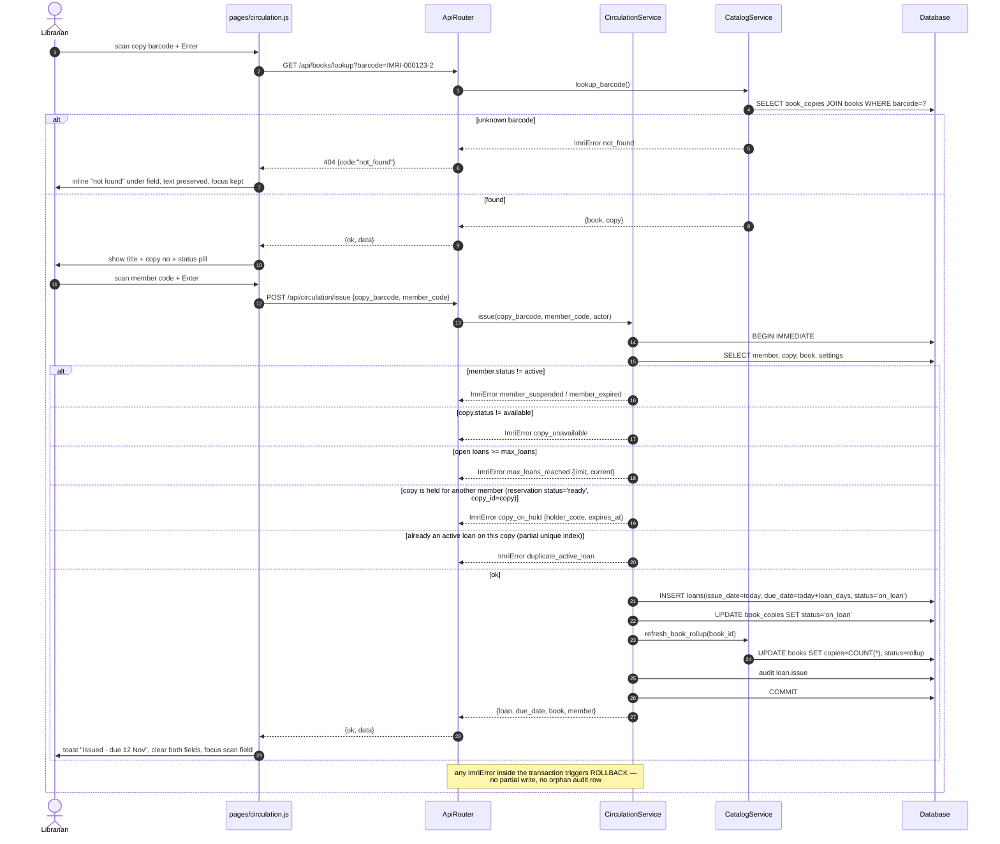
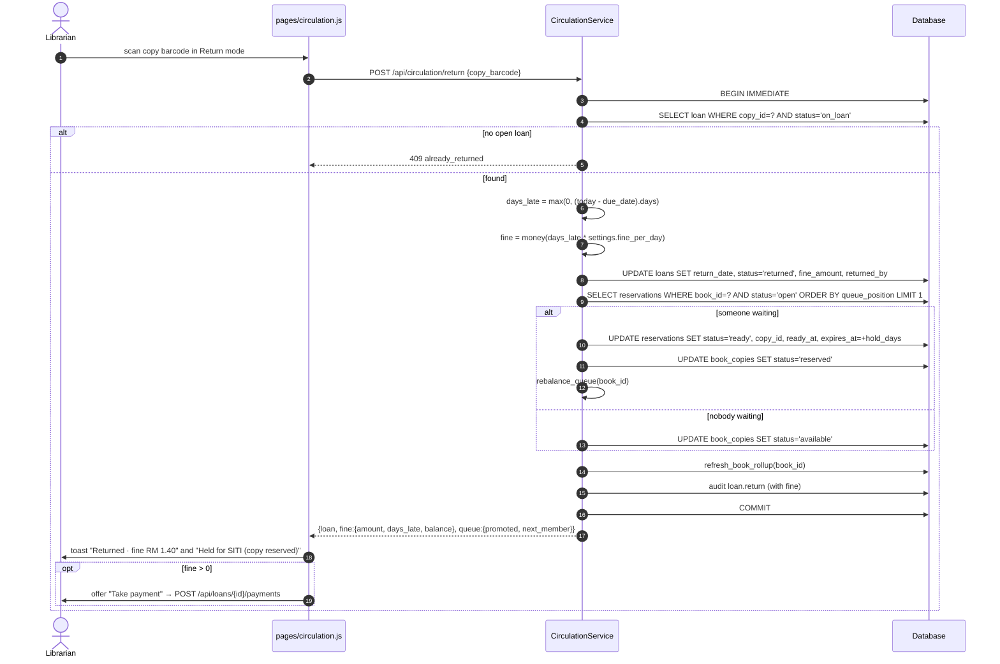
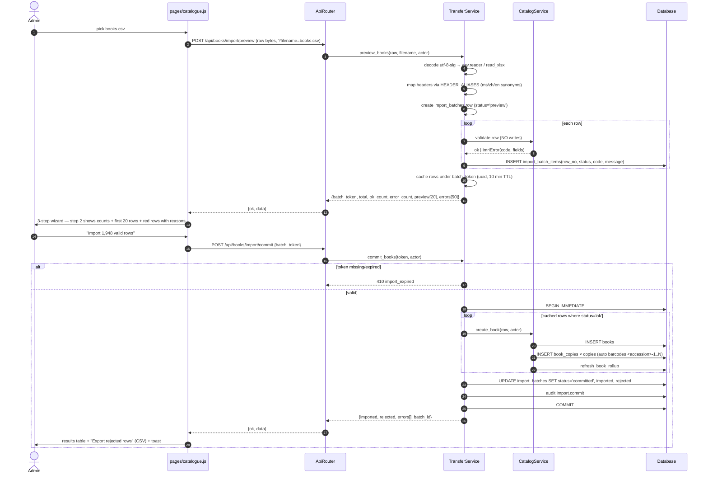

# IMRI — System Architecture

| | |
|---|---|
| **Product** | IMRI — offline library & resource-centre management for schools |
| **Version** | 1.0 (build-ready) |
| **Source of truth** | `docs/PRD.md` (93 requirements: 68 P0 / 19 P1 / 6 P2) |
| **Parity baseline** | HAZWANI (Python + Tkinter + SQLite), extracted at `reference/` |
| **Architect** | 高见远 (Gao) |
| **Target** | Windows 10/11, portable folder, Python 3.11 stdlib only, zero network |
| **Task plan** | `docs/TASKS.md` (5 tasks / 32 steps, traceability for all 68 P0 IDs) |

---

## 0. Decision summary (read this first)

```
main.py ──► resolve data/ ──► Database(SQLite, WAL) ──► HttpServer(127.0.0.1:ephemeral)
                                                              │
                                                    serves /api/* + /web/*
                                                              │
                                        msedge --app=http://127.0.0.1:PORT/
                                                              │
                                        page ── heartbeat ──► server ──► main.py exits
```

* **One process.** Python owns the database; the browser window is a pure view. No IPC beyond loopback HTTP.
* **No runtime dependencies.** `sqlite3`, `http.server`, `hashlib`, `zipfile`, `csv`, `zlib`, `ctypes`, `json` — all stdlib.
* **No build step.** Hand-written ES modules loaded natively by the bundled Edge/WebView2 engine.
* **Data is a folder.** `data/` beside the executable; nothing in the registry, AppData, or `%TEMP%` survives.

---

# Part A — System Design

## 1. Implementation approach

### 1.1 The hard problems, and how each is solved

| # | Challenge | Decision | Why this and not the obvious alternative |
|---|---|---|---|
| 1 | **"Modern slick UI" + "zero dependencies" are contradictory** (no React/Tailwind build, no CDN) | Hand-written ES-module frontend served from loopback, styled with CSS custom properties matching PRD §6 tokens | The only way to get a modern UI with literally zero install. A framework would need a build step (forbidden) or a CDN (forbidden). CSS variables give the whole design-token system for free. |
| 2 | **Tkinter cannot look modern** (reference is Tk) | Replace the entire view layer with HTML/CSS; keep Python for data only | Tk can't do 12px radii, 220ms transforms, blur backdrops, or inline SVG charts. Browsers do this natively at 60fps on a 4GB school PC. |
| 3 | **No browser chrome, no console window, must feel like an app** | `msedge --app=<url> --user-data-dir=<data>/browser-profile` → `chrome --app=` → `webbrowser.open` fallback; `pythonw`/`--windowed` build | `--app` gives a chromeless window with its own taskbar entry and no address bar. The dedicated `--user-data-dir` means our CSP, zoom and download settings don't touch the user's real browser profile. |
| 4 | **Server lifetime must equal window lifetime** | `pagehide` → `sendBeacon('/api/system/bye')` with a 3 s cancel-on-reload grace + a 2 s `/api/ping` heartbeat with a 120 s stale timeout | Browsers throttle hidden-tab timers to ~1/min, so heartbeat alone is too slow to notice a close and too eager if you rely on it alone. `pagehide` is instant but also fires on reload — hence the grace + cancel. Belt *and* braces: the heartbeat catches a browser crash. |
| 5 | **QR + Code 39 must be generated offline** | Own QR encoder (ISO/IEC 18004 byte mode, versions 1–10, GF(256) Reed–Solomon) and Code 39 pattern table, both emitting **SVG** | SVG scales crisply at any label size and needs no PNG encoder for the browser. The reference implementation is a proven, tested starting point (`reference/hazwani/qr.py`, `barcode.py`) — reuse the algorithm, change the output format to SVG. |
| 6 | **PDF export with no library** | Own PDF 1.4 writer (`zlib` for content streams), Helvetica base-14, pagination + header/footer | Proven in the reference (`reporting.write_pdf`). Only needs text positioning; reports are tables and headings. |
| 7 | **Per-copy lending** (new in IMRI) | `book_copies` is authoritative; `books.copies` is a denormalised count refreshed by exactly one helper | Legacy HAZWANI only knew "N copies of a title". A `copies` integer cannot express "copy 2 is lost, copy 3 is on the hold shelf". A single rollup helper prevents the classic drift bug. |
| 8 | **Tri-lingual with zero missing keys** | Dotted flat key catalogs (`en.js`/`ms.js`/`zh.js`), `t(key, vars)`, server returns **codes not sentences**, automated completeness test | Keeps language out of business logic. Server-side codes mean one place to translate every error. |
| 9 | **Concurrent writes on one SQLite file** | One long-lived connection, `isolation_level=None`, WAL, `synchronous=NORMAL`, `busy_timeout=5000`, one `RLock` around all writes, explicit `BEGIN IMMEDIATE` for multi-statement mutations | `ThreadingHTTPServer` serves requests on separate threads. A lock + WAL gives serialised writes without `SQLITE_BUSY` storms. Verified approach from the reference (`db.py`). |
| 10 | **Startup ≤2 s, catalogue paint ≤200 ms at 10k rows** | Server-side pagination (default 50) + **two-query page pattern** (ids first, then aggregates for just those ids) + windowed DOM rendering; client debounces search at 150 ms and aborts stale requests | Avoids N+1 and avoids rendering 10k rows. |

### 1.2 Architecture pattern

**Layered, service-oriented monolith.** No MVC because there is no server-side template layer: the frontend is a separate SPA-ish client and the backend is a JSON API. Layers, strictly one-directional:

```
web/js/*            view        (no business rules, no SQL)
  │ fetch
app/api/*           transport   (parse, authorise, delegate, serialise)
  │ python calls
app/{catalog,members,circulation,reporting,labels,transfer,backup}.py
                    domain      (validation + rules + SQL, no HTTP knowledge)
  │
app/db.py           persistence (schema, migration, transaction, settings, audit)
app/security.py     cross-cutting (hashing, sessions, RBAC, licence gate)
app/config.py       cross-cutting (paths, constants, logging)
```

Rule enforced by review: **only `db.py` touches `sqlite3`**; **only `api/` touches HTTP**; **domain modules never import `http.server`** and never raise `HTTPError` — they raise `ImriError(code, status, fields)` from `app/errors.py`… which is folded into `security.py`? No — `app/errors.py` is a 40-line module and is worth its own file (see file tree).

### 1.3 Framework / library selection

| Need | Choice | Justification |
|---|---|---|
| HTTP server | `http.server.ThreadingHTTPServer` | Stdlib, thread-per-request is plenty for one user, no async complexity, no event loop to get wrong in a frozen EXE. |
| Persistence | `sqlite3` + WAL | Stdlib, single file, transactional, supports window functions (3.42) for queue positions and partial unique indexes for "one active loan per copy". |
| Password KDF | `hashlib.scrypt` (n=2¹⁴, r=8, p=1), fallback `pbkdf2_hmac('sha256', 210_000)` | Memory-hard, C-accelerated via OpenSSL, ~80–120 ms on a school PC — fast enough to feel instant, slow enough to matter. Format string records the params so old hashes keep verifying and get upgraded on login. |
| Sessions | Random 32-byte token → `sha256` in DB, raw token in `HttpOnly` cookie | No JWT library, no signing key to leak, revocable server-side (needed for "admin reset password kills sessions"). |
| UI framework | **None** (ES modules + CSS variables) | Constraint. |
| Charts | Hand-rolled SVG (`charts.js`) | Constraint + PRD §6.5 requires 8px rounded bars and token-driven colours, which a library would fight. |
| QR / barcode | Own encoder → SVG | Constraint. |
| PDF | Own writer → PDF 1.4 | Constraint. |
| CSV/XLSX | `csv` + `zipfile`/`ElementTree` minimal OOXML | Constraint; the reference's `importexport.py` proves it works and is Excel-compatible. |
| Packaging | PyInstaller (`--onefile --windowed --add-data web`) | Only practical way to ship a single EXE; build-time only, never imported at runtime. |

### 1.4 Architecture Decisions (ADR)

| # | Decision | Rationale / consequence |
|---|---|---|
| ADR-01 | Licence code `arfanayub0` is a **module constant** compared with `hmac.compare_digest` after `strip().lower()`. No HMAC token format, no `keygen.py`. | PRD LIC-02/04. HAZWANI's HMAC scheme is explicitly *out* of scope — a single code cannot be forged if there is nothing to forge. |
| ADR-02 | `license.json` is primary, `settings.license_key` is the mirror; either one restores activation. | LIC-07 (deleting one file must not deactivate). |
| ADR-03 | Activation state is a **middleware gate**, not a route guard: every `/api/*` route except `/api/health`, `/api/bootstrap`, `/api/license/activate` returns `403 license_required` when unlicensed. | LIC-01 says "no route, API call or shortcut reaches app data" — enforced server-side so it cannot be bypassed by editing JS. |
| ADR-04 | `users.role` only; `access_level` is **derived** in `security.py` from a capability matrix. No stored integer level. | One source of truth; HAZWANI's `access_level` drifted out of sync with `role`. |
| ADR-05 | `books.copies` is a **denormalised total**, maintained only by `catalog.refresh_book_rollup(book_id)` inside the same transaction as the copy mutation. `available` is **never stored** — always `COUNT(*) WHERE status='available'`. | PRD §8 "derived, never stored". One helper = no drift. ADM-07 diagnostics re-checks it. |
| ADR-06 | `loans` keeps both FKs (`book_id`, `copy_id`, `member_id`) **and** denormalised `accession_no` / `member_code`. | FKs give integrity; denormalised keys give the report/search SQL parity with HAZWANI and make historical rows survive a rename. |
| ADR-07 | `CREATE UNIQUE INDEX ux_loans_active_copy ON loans(copy_id) WHERE status='on_loan'` | Makes "a copy can only be lent once" a database invariant, not an application hope. |
| ADR-08 | All money is `REAL`, rounded to 2dp at every write and read via `money(x)`. | PRD §8. Comparison uses `abs(a-b) < 0.005`. School-scale values only. |
| ADR-09 | Business dates (`issue_date`, `due_date`, `return_date`, `reserved_date`) are **local** `YYYY-MM-DD`. Timestamps (`created_at`, `paid_at`, `ts`) are **UTC** ISO-8601 with `Z`. | Overdue maths must follow the librarian's wall clock, not UTC — a 00:30 return in Kuala Lumpur must not be "yesterday". |
| ADR-10 | IDs: `INTEGER PRIMARY KEY AUTOINCREMENT`; business keys (`accession_no`, `member_code`, `barcode`) are `UNIQUE` and immutable. API exposes both; URLs use numeric `id`. | Renaming a member code must not break bookmarks. |
| ADR-11 | No soft delete in 1.0 (UX-10 is P2). Deletes are hard, guarded by FK `RESTRICT` + explicit pre-checks, and always audited. | A soft-delete column that nothing filters on is a data-leak waiting to happen. Deferred deliberately. |
| ADR-12 | Exports (CSV/PDF) are written to `data/exports/` and the API returns `{path, filename, size}`; a `POST /api/system/reveal` opens Explorer at the file. | In a portable folder, "my report went to Downloads" is a support call. |
| ADR-13 | Login sets `HttpOnly; SameSite=Strict` cookie **without** `Secure` (loopback is `http`), and every mutating request must carry `X-IMRI-CSRF: 1` + a same-origin `Origin`/`Sec-Fetch-Site` check. | `Secure` would break `http://127.0.0.1`. The custom header is the CSRF defence that does not need TLS. |
| ADR-14 | Import is two-phase: `preview` parses + validates with **zero writes** and caches rows server-side under a `batch_token` (10 min TTL); `commit` inserts only the rows that passed. | PRD CAT-09 "a bad file never half-loads". Caching server-side avoids re-uploading 2,000 rows and avoids trusting a client-sent row list. |
| ADR-15 | Reservation `queue_position` is recomputed with a window function over `status IN ('open','ready')` for that book after every mutation. | Positions must never have gaps or duplicates; recomputation is O(queue) and queues are tiny. |
| ADR-16 | `member_type` (`student`/`teacher`/`patron`) added to `members`. | MEM-01 explicitly names three member kinds; reports need to group by it. |
| ADR-17 | Single-instance guard: `data/.lock` created with `O_EXCL` holding the PID; a live PID means "already running" → open the URL and exit. | Two processes on one WAL file will corrupt the librarian's afternoon. |
| ADR-18 | P2 features (class reading lists, idle auto-lock, undo-delete, member photos/expiry auto-transition, saved filter views) are **not** in the schema. They arrive via a future migration. | Do not design tables for features nobody has written. `schema_meta.version` + idempotent migrations make adding them cheap. |

---

## 2. File tree

44 files. `imri/` is the Python package; `web/` is shipped as data.

```
imri/
├─ main.py                          Entry: resolve dirs, acquire lock, open DB, start server, launch app window, wait for close, checkpoint + shutdown
├─ run.bat                          `start "" pythonw main.py` — dev launcher, no console
├─ build.bat                        Thin wrapper: `python build_exe.py`
├─ build_exe.py                     PyInstaller one-file windowed build, `--add-data web;web`, prints the EXE path
├─ README.md                        Operator guide: first run, activation, backup/restore, RESET-ADMIN recovery
│
├─ imri/
│  ├─ __init__.py                   Package marker + `__version__`
│  ├─ config.py                     Paths (frozen vs dev, `sys._MEIPASS`), APP_NAME/VERSION/SCHEMA_VERSION, defaults, logging setup, `now_utc()`/`today_local()`/`money()`
│  ├─ errors.py                     `ImriError(code, status=400, fields=None)`, the canonical error-code constants, HTTP status mapping
│  ├─ db.py                         DDL for every table/index/trigger, `Migrator`, `Database` (single conn, WAL, RLock, `transaction()`, `query/execute`, settings, audit, checkpoint, integrity_check)
│  ├─ security.py                   scrypt/PBKDF2 hash+verify+rehash, `SessionStore`, capability matrix (`ROLE_CAPS`), `require(cap)`, login rate limit, licence gate (`LicenseGate`)
│  ├─ catalog.py                    Books CRUD, per-copy CRUD, `refresh_book_rollup`, ISBN/DDC/LCC/call-no validation, subjects + languages vocabulary, MARC21-lite blob, duplicate detection, barcode/accession generation
│  ├─ members.py                    Members CRUD + search + profile aggregates, IC/MyKad validation, reading-list CRUD and "reserve from list"
│  ├─ circulation.py                issue/return/renew, fine maths, payments + receipts, waivers, lost/damaged, reservation queue (`rebalance_queue`), hold expiry, overdue queries
│  ├─ reporting.py                  Collection / circulation / membership / overdue-fines / trend queries + report definitions as `{title, columns, rows}`
│  ├─ labels.py                     QR encoder (byte mode, RS/GF256, mask scoring) + Code 39 + SVG renderers + A4 sheet layout
│  ├─ transfer.py                   CSV/XLSX read+write, header alias map, formula-injection guard, import preview/commit cache, backup/restore zip with manifest + path guards
│  ├─ nfc.py                        PC/SC bridge over `ctypes`+`winscard.dll`: detect reader, read UID/text, write short payload — every call returns (ok, value_or_reason), never raises
│  ├─ server.py                     `ThreadingHTTPServer`, static file serving with traversal guard, JSON envelope, middleware chain, CSP headers, app-window launcher, heartbeat/`bye` lifecycle, `/api/system/reveal`
│  └─ api/
│     ├─ __init__.py                `ROUTES` table, path-param matching, dispatch, envelope, query/pagination parsing, `@route` decorator
│     ├─ core.py                    health, bootstrap, licence activate/status, auth (login/logout/session/password), dashboard, global search, settings, users, audit, diagnostics, system
│     ├─ library.py                 books (+copies, subjects, MARC, duplicates, lookup, bulk), members (+reading lists), import/export for both
│     ├─ circulation.py             issue, return, renew, loans, payments, waive, lost, fines, reservations, hold expiry
│     └─ insights.py                reports (+CSV/PDF export), labels (QR/Code39/sheet), backup list/create/restore/delete
│
├─ web/
│  ├─ index.html                    Single page: CSP meta, `<div id="app">`, module bootstrap, no inline JS
│  ├─ css/
│  │  └─ app.css                    ALL styles: tokens (light/dark), reset, shell, sidebar, topbar, cards, tables, forms, modal, drawer, toast, palette, charts, skeletons, print
│  └─ js/
│     ├─ app.js                     Bootstrap: load i18n + settings, mount shell, register routes, restore theme/lang, start heartbeat, global error handler
│     ├─ api.js                     `api.get/post/patch/del/upload`, envelope unwrap, error→`ImriError`, 401/403 interception, AbortController, CSRF header
│     ├─ store.js                   Tiny observable store: session, settings, theme, lang, list state (filters/sort/page) with session persistence
│     ├─ i18n.js                    `t(key, vars)`, `setLang`, locale-aware `fmtDate`/`fmtMoney`/`fmtNum`, completeness check
│     ├─ lang/en.js                 English catalogue (~600 keys)
│     ├─ lang/ms.js                 Bahasa Melayu catalogue (same key set)
│     ├─ lang/zh.js                 中文 catalogue (same key set)
│     ├─ ui.js                      DOM helpers + component kit: `el`, `icon`, button/input/select, table (sort/paginate/select), pills, chips, modal, drawer, confirm, toast, skeleton, empty/error state, form-field with inline error
│     ├─ charts.js                  Inline SVG bar / donut / sparkline, token-coloured, mount animation, reduced-motion aware
│     ├─ router.js                  Hash router (`#/catalogue?q=..&page=2`), route table, guards (licence → login → screen), 120ms fade
│     ├─ shell.js                   Sidebar (collapsible), topbar, licence badge, overdue bell, theme toggle, language chip, avatar menu, Ctrl+K palette, global search, shortcut sheet
│     └─ pages/
│        ├─ auth.js                 Activation gate + login (+ default-password banner)
│        ├─ dashboard.js            6 KPI cards, due/overdue lists, 2 charts, quick actions, alerts strip
│        ├─ catalogue.js            Search-first list, filter chips, detail drawer, editor modal, copies panel, MARC viewer, import wizard (3 steps)
│        ├─ members.js              List, detail drawer (loans/history/fines/reservations/reading list), editor modal, member card preview
│        ├─ circulation.js          Scan counter (issue/return), overdue & fines with payment dialog, reservations queue with positions
│        ├─ insights.js             Reports (range picker, 5 report kinds, CSV/PDF), Labels (QR/Code39 preview, size options, batch sheet)
│        └─ admin.js                5 tabs: Licence & About, Settings, Users & Roles, Backup/Restore, Audit Log (+ diagnostics)
│
└─ tests/
   ├─ run_all.py                    Discover + run every test module, print a pass/fail summary, exit code
   ├─ helpers.py                    Temp-dir DB fixture, seeded fixtures (books/copies/members/loans), fake request/response for API tests
   ├─ test_db.py                    DDL applies twice (idempotent), migration from v0, rollup consistency, audit append-only triggers, settings defaults
   ├─ test_security.py              scrypt round-trip, rehash-on-login, capability matrix, session expiry, licence accept/reject/cooldown, RESET-ADMIN
   ├─ test_catalog.py               ISBN-10/13 check digits + conversion, DDC/LCC validation, copy auto-generation, rollup after copy ops, duplicate detection
   ├─ test_circulation.py           fine across month/year boundaries, max_loans, renewal blocking, queue positions, hold expiry, partial payments, overpayment rejected, one-active-loan-per-copy
   ├─ test_transfer.py              CSV/XLSX round-trip, header aliases, dry-run performs zero writes, commit imports only valid rows, backup manifest + tamper refusal, restore safety snapshot
   └─ test_api.py                   Envelope shape, licence gate 403, 401/403 matrix, pagination meta, error codes for the 12 riskiest domain failures, i18n key completeness
```

**Counts:** 1 entry + 11 domain/infra modules + 1 API package (5 files) = 17 Python; 1 HTML + 1 CSS + 18 JS = 20 frontend; 7 tests; 4 root support files.

---

## 3. Database

### 3.1 Principles

* One file: `data/imri.db`. `PRAGMA foreign_keys=ON`, `journal_mode=WAL`, `synchronous=NORMAL`, `busy_timeout=5000`.
* One long-lived connection, `isolation_level=None`, guarded by a single `RLock` for writes.
* Multi-statement mutations use `db.transaction()` → `BEGIN IMMEDIATE` … `COMMIT` / `ROLLBACK`, so a row and its audit entry are one journal write (proven ~2× faster saves in the reference).
* Every statement parameterised. Zero string interpolation of user input into SQL — the one exception is a **fixed column allow-list** validated against a set literal.
* Derived, never stored: `available` copies, outstanding balance, queue position ordering, overdue days, accrued fine on an open loan.

### 3.2 Schema versioning + migration

```python
SCHEMA_VERSION = 1   # in config.py

class Migrator:
    """Idempotent: safe to run on every start, on a fresh file, and on a file
    written by any older build."""

    STEPS = {}       # {2: _v2_add_class_lists, 3: ...}  — future

    def ensure(self, conn):
        conn.executescript(DDL)                 # CREATE TABLE/INDEX/TRIGGER IF NOT EXISTS
        row = conn.execute("SELECT version FROM schema_meta WHERE id=1").fetchone()
        cur = row[0] if row else 0
        if cur > SCHEMA_VERSION:
            raise ImriError("db_newer_than_app", 500,
                            {"found": cur, "supported": SCHEMA_VERSION})
        for v in range(cur + 1, SCHEMA_VERSION + 1):
            self.STEPS.get(v, lambda c: None)(conn)   # forward-only, each in its own txn
        conn.execute(
            "INSERT INTO schema_meta(id, version, app_version, applied_at) VALUES (1,?,?,?) "
            "ON CONFLICT(id) DO UPDATE SET version=excluded.version, "
            "app_version=excluded.app_version, applied_at=excluded.applied_at",
            (SCHEMA_VERSION, APP_VERSION, now_utc()))
        conn.commit()
```

Rules the engineer must follow:

1. **Order matters:** `executescript(DDL)` → read version → run steps → write version. Never create an index before the migration that adds its column (the reference had exactly this bug and it made legacy DBs unstartable).
2. Each migration step is a **function**, never raw SQL inline, and must be safe to run on an already-migrated file (`PRAGMA table_info` guards for `ADD COLUMN`).
3. `ALTER TABLE ADD COLUMN` accepts only constant defaults — no `datetime('now')`.
4. A DB with `version > SCHEMA_VERSION` refuses to start with a plain-language dialog (`db_newer_than_app`) rather than corrupting data.

### 3.3 DDL (complete)

```sql
-- ============================================================ 0. meta
CREATE TABLE IF NOT EXISTS schema_meta (
    id          INTEGER PRIMARY KEY CHECK (id = 1),
    version     INTEGER NOT NULL,
    app_version TEXT,
    applied_at  TEXT    NOT NULL
);

CREATE TABLE IF NOT EXISTS settings (
    key        TEXT PRIMARY KEY,
    value      TEXT NOT NULL DEFAULT '',
    updated_at TEXT
);

-- ============================================================ 1. people
CREATE TABLE IF NOT EXISTS users (
    id                   INTEGER PRIMARY KEY AUTOINCREMENT,
    username             TEXT    NOT NULL COLLATE NOCASE UNIQUE,
    password_hash        TEXT    NOT NULL,          -- 'scrypt$ln=14,r=8,p=1$<salt_b64>$<dk_b64>'
    display_name         TEXT    NOT NULL DEFAULT '',
    role                 TEXT    NOT NULL DEFAULT 'assistant'
                         CHECK (role IN ('admin','librarian','assistant','viewer')),
    is_active            INTEGER NOT NULL DEFAULT 1 CHECK (is_active IN (0,1)),
    must_change_password INTEGER NOT NULL DEFAULT 0 CHECK (must_change_password IN (0,1)),
    password_changed_at  TEXT,
    last_login_at        TEXT,
    created_at           TEXT    NOT NULL,
    updated_at           TEXT    NOT NULL
);

CREATE TABLE IF NOT EXISTS sessions (
    token_hash   TEXT PRIMARY KEY,                  -- sha256(raw token) hex; raw only in cookie
    user_id      INTEGER NOT NULL REFERENCES users(id) ON DELETE CASCADE,
    created_at   TEXT NOT NULL,
    last_seen_at TEXT NOT NULL,
    expires_at   TEXT NOT NULL,
    client       TEXT
);
CREATE INDEX IF NOT EXISTS ix_sessions_user ON sessions(user_id);
CREATE INDEX IF NOT EXISTS ix_sessions_exp  ON sessions(expires_at);

CREATE TABLE IF NOT EXISTS members (
    id              INTEGER PRIMARY KEY AUTOINCREMENT,
    member_code     TEXT NOT NULL UNIQUE,
    name            TEXT NOT NULL,
    member_type     TEXT NOT NULL DEFAULT 'student'
                    CHECK (member_type IN ('student','teacher','patron')),
    ic_number       TEXT,
    form            TEXT,
    class_name      TEXT,
    address         TEXT,
    phone           TEXT,
    email           TEXT,
    photo_path      TEXT,
    membership_date TEXT NOT NULL,
    expiry_date     TEXT,
    status          TEXT NOT NULL DEFAULT 'active'
                    CHECK (status IN ('active','suspended','expired')),
    note            TEXT,
    created_at      TEXT NOT NULL,
    updated_at      TEXT NOT NULL
);
CREATE INDEX IF NOT EXISTS ix_members_name   ON members(name COLLATE NOCASE);
CREATE INDEX IF NOT EXISTS ix_members_ic     ON members(ic_number);
CREATE INDEX IF NOT EXISTS ix_members_status ON members(status);
CREATE INDEX IF NOT EXISTS ix_members_class  ON members(class_name);

-- ============================================================ 2. catalogue
CREATE TABLE IF NOT EXISTS books (
    id             INTEGER PRIMARY KEY AUTOINCREMENT,
    accession_no   TEXT NOT NULL UNIQUE,
    isbn           TEXT,                       -- normalised ISBN-13 when available
    isbn10         TEXT,                       -- derived on save
    title          TEXT NOT NULL,
    subtitle       TEXT,
    authors        TEXT,                       -- display string; authorities table holds headings
    publisher      TEXT,
    pub_year       TEXT,
    edition        TEXT,
    language       TEXT NOT NULL DEFAULT 'en', -- primary language; M2M in book_languages
    dewey          TEXT,                       -- '###(.###)?'
    classification TEXT NOT NULL DEFAULT 'ddc' CHECK (classification IN ('ddc','lcc','local')),
    call_no        TEXT,
    subjects       TEXT,                       -- denormalised display; authoritative = book_subjects
    material_type  TEXT NOT NULL DEFAULT 'book'
                   CHECK (material_type IN ('book','textbook','reference','magazine',
                                            'av','kit','thesis','other')),
    location       TEXT,
    copies         INTEGER NOT NULL DEFAULT 1 CHECK (copies >= 0),  -- denorm = COUNT(book_copies)
    price          REAL    NOT NULL DEFAULT 0 CHECK (price >= 0),
    currency       TEXT    NOT NULL DEFAULT 'RM',
    synopsis       TEXT,
    marc_blob      TEXT,                       -- JSON MARC21-lite, unknown tags preserved verbatim
    cover_path     TEXT,                       -- relative to data/covers/
    barcode        TEXT,
    status         TEXT NOT NULL DEFAULT 'available'
                   CHECK (status IN ('available','on_loan','unavailable','lost','withdrawn')),
    source         TEXT NOT NULL DEFAULT 'manual',
    created_at     TEXT NOT NULL,
    updated_at     TEXT NOT NULL
);
CREATE INDEX IF NOT EXISTS ix_books_isbn     ON books(isbn);
CREATE INDEX IF NOT EXISTS ix_books_title    ON books(title COLLATE NOCASE);
CREATE INDEX IF NOT EXISTS ix_books_author   ON books(authors COLLATE NOCASE);
CREATE INDEX IF NOT EXISTS ix_books_dewey    ON books(dewey);
CREATE INDEX IF NOT EXISTS ix_books_callno   ON books(call_no);
CREATE INDEX IF NOT EXISTS ix_books_material ON books(material_type);
CREATE INDEX IF NOT EXISTS ix_books_lang     ON books(language);
CREATE INDEX IF NOT EXISTS ix_books_status   ON books(status);

CREATE TABLE IF NOT EXISTS book_copies (
    id          INTEGER PRIMARY KEY AUTOINCREMENT,
    book_id     INTEGER NOT NULL REFERENCES books(id) ON DELETE CASCADE,
    copy_no     INTEGER NOT NULL CHECK (copy_no >= 1),
    barcode     TEXT    NOT NULL UNIQUE,
    status      TEXT    NOT NULL DEFAULT 'available'
                CHECK (status IN ('available','on_loan','reserved','lost','damaged','withdrawn')),
    location    TEXT,
    condition   TEXT    CHECK (condition IS NULL OR condition IN ('new','good','fair','poor')),
    acquired_at TEXT,
    note        TEXT,
    created_at  TEXT NOT NULL,
    updated_at  TEXT NOT NULL,
    UNIQUE (book_id, copy_no)
);
CREATE INDEX IF NOT EXISTS ix_copies_book   ON book_copies(book_id, status);
CREATE INDEX IF NOT EXISTS ix_copies_status ON book_copies(status);

CREATE TABLE IF NOT EXISTS subjects (
    id         INTEGER PRIMARY KEY AUTOINCREMENT,
    heading    TEXT NOT NULL COLLATE NOCASE UNIQUE,
    scope_note TEXT
);
CREATE TABLE IF NOT EXISTS book_subjects (
    book_id    INTEGER NOT NULL REFERENCES books(id)    ON DELETE CASCADE,
    subject_id INTEGER NOT NULL REFERENCES subjects(id) ON DELETE CASCADE,
    PRIMARY KEY (book_id, subject_id)
);
CREATE INDEX IF NOT EXISTS ix_booksub_subject ON book_subjects(subject_id);

CREATE TABLE IF NOT EXISTS book_languages (
    book_id INTEGER NOT NULL REFERENCES books(id) ON DELETE CASCADE,
    lang    TEXT    NOT NULL,
    PRIMARY KEY (book_id, lang)
);

CREATE TABLE IF NOT EXISTS authorities (
    id   INTEGER PRIMARY KEY AUTOINCREMENT,
    name TEXT NOT NULL COLLATE NOCASE UNIQUE,
    type TEXT NOT NULL DEFAULT 'person'
         CHECK (type IN ('person','corporate','conference'))
);

-- ============================================================ 3. circulation
CREATE TABLE IF NOT EXISTS loans (
    id            INTEGER PRIMARY KEY AUTOINCREMENT,
    book_id       INTEGER NOT NULL REFERENCES books(id)       ON DELETE RESTRICT,
    copy_id       INTEGER          REFERENCES book_copies(id) ON DELETE RESTRICT,
    accession_no  TEXT    NOT NULL,                 -- denorm, immutable snapshot
    member_id     INTEGER NOT NULL REFERENCES members(id)     ON DELETE RESTRICT,
    member_code   TEXT    NOT NULL,                 -- denorm, immutable snapshot
    issue_date    TEXT    NOT NULL,                 -- local YYYY-MM-DD
    due_date      TEXT    NOT NULL,
    return_date   TEXT,
    renewal_count INTEGER NOT NULL DEFAULT 0 CHECK (renewal_count >= 0),
    status        TEXT    NOT NULL DEFAULT 'on_loan'
                  CHECK (status IN ('on_loan','returned','lost','damaged')),
    fine_amount   REAL    NOT NULL DEFAULT 0 CHECK (fine_amount   >= 0),
    paid_amount   REAL    NOT NULL DEFAULT 0 CHECK (paid_amount   >= 0),
    waived_amount REAL    NOT NULL DEFAULT 0 CHECK (waived_amount >= 0),
    currency      TEXT    NOT NULL DEFAULT 'RM',
    issued_by     TEXT,
    returned_by   TEXT,
    note          TEXT,
    created_at    TEXT NOT NULL,
    updated_at    TEXT NOT NULL
);
-- A copy may be on loan at most once. Database invariant, not app hope.
CREATE UNIQUE INDEX IF NOT EXISTS ux_loans_active_copy ON loans(copy_id) WHERE status = 'on_loan';
CREATE INDEX IF NOT EXISTS ix_loans_open   ON loans(status, due_date);
CREATE INDEX IF NOT EXISTS ix_loans_member ON loans(member_id, status);
CREATE INDEX IF NOT EXISTS ix_loans_book   ON loans(book_id, status);
CREATE INDEX IF NOT EXISTS ix_loans_copy   ON loans(copy_id, status);
CREATE INDEX IF NOT EXISTS ix_loans_issue  ON loans(issue_date);
CREATE INDEX IF NOT EXISTS ix_loans_due    ON loans(due_date);

CREATE TABLE IF NOT EXISTS fine_payments (
    id         INTEGER PRIMARY KEY AUTOINCREMENT,
    loan_id    INTEGER NOT NULL REFERENCES loans(id)   ON DELETE CASCADE,
    member_id  INTEGER NOT NULL REFERENCES members(id) ON DELETE RESTRICT,
    amount     REAL    NOT NULL CHECK (amount > 0),
    paid_at    TEXT    NOT NULL,                 -- UTC ISO-8601
    receipt_no TEXT    NOT NULL UNIQUE,          -- IMRI-R-YYYYMMDD-NNNN
    method     TEXT    NOT NULL DEFAULT 'cash' CHECK (method IN ('cash','other')),
    actor      TEXT    NOT NULL,
    note       TEXT,
    created_at TEXT    NOT NULL
);
CREATE INDEX IF NOT EXISTS ix_pay_loan   ON fine_payments(loan_id);
CREATE INDEX IF NOT EXISTS ix_pay_member ON fine_payments(member_id, paid_at);

CREATE TABLE IF NOT EXISTS reservations (
    id            INTEGER PRIMARY KEY AUTOINCREMENT,
    book_id       INTEGER NOT NULL REFERENCES books(id)   ON DELETE CASCADE,
    member_id     INTEGER NOT NULL REFERENCES members(id) ON DELETE CASCADE,
    accession_no  TEXT    NOT NULL,
    member_code   TEXT    NOT NULL,
    copy_id       INTEGER          REFERENCES book_copies(id) ON DELETE SET NULL,
    reserved_date TEXT    NOT NULL,
    queue_position INTEGER NOT NULL DEFAULT 0,
    status        TEXT    NOT NULL DEFAULT 'open'
                  CHECK (status IN ('open','ready','fulfilled','expired','cancelled')),
    ready_at      TEXT,
    expires_at    TEXT,
    note          TEXT,
    created_at    TEXT NOT NULL,
    updated_at    TEXT NOT NULL
);
-- One live reservation per member per title.
CREATE UNIQUE INDEX IF NOT EXISTS ux_res_active
    ON reservations(book_id, member_id) WHERE status IN ('open','ready');
CREATE INDEX IF NOT EXISTS ix_res_queue  ON reservations(book_id, status, queue_position);
CREATE INDEX IF NOT EXISTS ix_res_member ON reservations(member_id, status);

CREATE TABLE IF NOT EXISTS reading_lists (
    id         INTEGER PRIMARY KEY AUTOINCREMENT,
    member_id  INTEGER NOT NULL REFERENCES members(id) ON DELETE CASCADE,
    book_id    INTEGER NOT NULL REFERENCES books(id)   ON DELETE CASCADE,
    note       TEXT,
    sort_order INTEGER NOT NULL DEFAULT 0,
    created_at TEXT NOT NULL,
    UNIQUE (member_id, book_id)
);
CREATE INDEX IF NOT EXISTS ix_rl_member ON reading_lists(member_id, sort_order);

-- ============================================================ 4. audit + import
CREATE TABLE IF NOT EXISTS audit_log (
    id          INTEGER PRIMARY KEY AUTOINCREMENT,
    ts          TEXT NOT NULL,                   -- UTC ISO-8601
    actor       TEXT NOT NULL DEFAULT 'system',
    actor_id    INTEGER,
    action      TEXT NOT NULL,                   -- 'book.create', 'loan.issue', 'auth.login' …
    target      TEXT,
    target_type TEXT,
    detail      TEXT,                            -- JSON string, never secrets
    ip          TEXT
);
CREATE INDEX IF NOT EXISTS ix_audit_ts     ON audit_log(ts);
CREATE INDEX IF NOT EXISTS ix_audit_actor  ON audit_log(actor, ts);
CREATE INDEX IF NOT EXISTS ix_audit_action ON audit_log(action, ts);

CREATE TRIGGER IF NOT EXISTS trg_audit_no_update BEFORE UPDATE ON audit_log
BEGIN SELECT RAISE(ABORT, 'audit_log is append-only'); END;
CREATE TRIGGER IF NOT EXISTS trg_audit_no_delete BEFORE DELETE ON audit_log
BEGIN SELECT RAISE(ABORT, 'audit_log is append-only'); END;

CREATE TABLE IF NOT EXISTS import_batches (
    id           INTEGER PRIMARY KEY AUTOINCREMENT,
    filename     TEXT,
    kind         TEXT NOT NULL DEFAULT 'books' CHECK (kind IN ('books','members')),
    row_count    INTEGER NOT NULL DEFAULT 0,
    imported     INTEGER NOT NULL DEFAULT 0,
    rejected     INTEGER NOT NULL DEFAULT 0,
    status       TEXT NOT NULL DEFAULT 'preview'
                 CHECK (status IN ('preview','committed','cancelled','failed')),
    actor        TEXT,
    created_at   TEXT NOT NULL,
    completed_at TEXT
);
CREATE TABLE IF NOT EXISTS import_batch_items (
    id        INTEGER PRIMARY KEY AUTOINCREMENT,
    batch_id  INTEGER NOT NULL REFERENCES import_batches(id) ON DELETE CASCADE,
    row_no    INTEGER NOT NULL,
    key_value TEXT,
    status    TEXT NOT NULL CHECK (status IN ('ok','error','warning')),
    code      TEXT,
    message   TEXT
);
CREATE INDEX IF NOT EXISTS ix_ibi_batch ON import_batch_items(batch_id, status);
```

### 3.4 Seeded settings

| Key | Default | Used by |
|---|---|---|
| `school_name` | `My School Resource Centre` | Topbar, PDF header, licence record |
| `currency` | `RM` | All money display |
| `currency_space` | `1` | `RM 12.50` vs `RM12.50` (I18N-03) |
| `fine_per_day` | `0.20` | CIR-02 |
| `loan_days` | `14` | CIR-05 |
| `max_loans` | `3` | CIR-05 |
| `max_renewals` | `1` | CIR-03 |
| `hold_days` | `3` | CIR-09/10 |
| `label_prefix` | `IMRI` | CAT-12 barcode generation |
| `default_locale` | `en` | I18N-01 |
| `theme` | `system` | UX-05 |
| `license_key` / `license_edition` / `license_activated_at` / `license_school` | `''` / `''` / `''` / `''` | LIC-03 mirror |
| `backup_on_exit` / `backup_keep` | `0` / `10` | BAK-04 |
| `page_size_default` | `50` | UX-07 |
| `idle_lock_minutes` | `0` (off) | ADM-08 (P2) |

### 3.5 Derived-value rules (the only place these are computed)

| Derived value | Rule | Where |
|---|---|---|
| `available` copies of a book | `COUNT(*) FROM book_copies WHERE book_id=? AND status='available'` | `catalog.available_copies()` |
| `books.copies` | `COUNT(*) FROM book_copies WHERE book_id=?` — written **only** by `catalog.refresh_book_rollup()` | same |
| `books.status` rollup | `available` if any copy available; else `on_loan` if any on_loan; else `unavailable` | same helper |
| Overdue days (open loan) | `max(0, (today_local - due_date).days)` | `circulation.overdue_days()` |
| Accrued fine (open loan) | `money(overdue_days * fine_per_day)` | `circulation.accrued_fine()` |
| Final fine (on return) | `money(max(0,(return_date - due_date).days) * fine_per_day_at_return)` | `circulation.return_copy()` |
| Outstanding balance | `money(max(0, fine_amount - paid_amount - waived_amount))` | `circulation.balance()` |
| Queue position | `ROW_NUMBER() OVER (PARTITION BY book_id ORDER BY reserved_date, id)` over `status IN ('open','ready')` | `circulation.rebalance_queue(book_id)` |

---

## 4. REST API contract

### 4.1 Conventions

* Base: `http://127.0.0.1:<port>/api`. JSON in, JSON out, `UTF-8`, `Cache-Control: no-store`.
* **Envelope (success):** `{"ok": true, "data": <payload>, "meta": {...}}` — `meta` only on lists.
* **Envelope (failure):** `{"ok": false, "error": {"code": "...", "message": "...", "fields": {"isbn": "invalid_isbn"}, "details": {...}}}`
  * `code` is a stable machine token the client maps to `err.<code>` in the active language.
  * `message` is a developer-facing English fallback; the UI never shows it directly.
* **Pagination:** `?page=1&page_size=50&sort=title&order=asc` → `meta: {page, page_size, total, pages, sort, order}`. `page_size` clamped to `[1,200]`, default 50.
* **Auth:** `Cookie: imri_sid=<token>` (`HttpOnly; SameSite=Strict; Path=/; Max-Age=43200`). `X-IMRI-Token: <token>` also accepted (headless/tests).
* **CSRF:** every `POST/PATCH/PUT/DELETE` must send `X-IMRI-CSRF: 1` and a same-origin `Origin` or `Sec-Fetch-Site: same-origin`.
* **Errors → HTTP:** 400 malformed, 401 `auth_required`, 403 `license_required`/`forbidden`, 404 `not_found`, 409 domain conflict, 413 too large, 415 wrong content type, 422 `validation_failed`, 429 `rate_limited`, 500 `internal`, 503 `db_busy`.

### 4.2 Middleware chain (order is load-bearing)

```
1  static asset?  → serve (path guard) 
2  /api/health     → 200 always
3  body size guard → 413 if > 8 MB (imports stream to a temp file)
4  licence gate    → 403 license_required unless licensed or path is
                     /api/bootstrap | /api/license/activate
5  session         → 401 auth_required (except /api/bootstrap, /api/auth/login)
6  CSRF/origin     → 403 forbidden on mutating requests
7  capability      → 403 forbidden (route declares required capability)
8  handler         → ImriError → mapped status + code; unexpected → 500 internal + log
```

### 4.3 Endpoints

Legend — **Perm** is the capability string from §8.3. `—` = no session required.

#### System, licence, auth

| Method | Path | Request | Response `data` | Perm |
|---|---|---|---|---|
| GET | `/api/health` | — | `{status:"ok", version, schema, uptime_s}` | — |
| GET | `/api/bootstrap` | — | `{licensed, license:{edition,activated_at,school_name}, session:{user,role,caps}\|null, settings:{school_name,currency,currency_space,default_locale,theme,page_size_default}, version, schema}` | — |
| POST | `/api/license/activate` | `{code}` | `{licensed:true, activated_at, school_name, edition}` · 403 `invalid_license_code` (+`details.retry_after_s` after 5 failures) | — (rate-limited) |
| GET | `/api/license` | — | `{edition:"perpetual", activated_at, school_name, product, version, schema}` | `license.read` |
| POST | `/api/auth/login` | `{username, password}` | `{user:{id,username,display_name,role,caps}, must_change_password, default_password_warning}` + `Set-Cookie` · 401 `invalid_credentials` · 429 `rate_limited` | — |
| POST | `/api/auth/logout` | — | `{logged_out:true}` | `—` (session optional) |
| GET | `/api/auth/session` | — | `{user, must_change_password}` · 401 | `—` |
| POST | `/api/auth/password` | `{current_password, new_password}` | `{changed:true}` · 422 `weak_password`/`wrong_password` | `—` (own account) |
| POST | `/api/auth/heartbeat` | — | `{alive:true, server_time}` | `—` |
| POST | `/api/system/bye` | — | `204` (arms a 3 s shutdown grace) | — (pagehide beacon) |
| POST | `/api/system/reveal` | `{path}` | `{revealed:true}` (Explorer select; path must resolve inside `data/`) | `system.reveal` |
| GET | `/api/system/info` | — | `{version, schema, python, db_path, data_dir, row_counts, license}` | `system.diag` |
| GET | `/api/system/diagnostics` | — | `{integrity, orphans:{loans,copies,reservations}, rollup_mismatches, backup_count, last_backup}` | `system.diag` |

#### Dashboard & search

| Method | Path | Request | Response `data` | Perm |
|---|---|---|---|---|
| GET | `/api/dashboard` | `?as_of=YYYY-MM-DD` | `{kpis:{titles,copies,active_members,on_loan,overdue,fines_outstanding, each with delta_30d}, due_today:[…5], overdue:[…5], charts:{loans_by_month:[{month,count}]×12, collection_by_type:[{type,count}]}, alerts:[{kind,count,items}]}` | `dashboard.read` |
| GET | `/api/search` | `?q&limit=5` | `{books:{count,items[]}, members:{count,items[]}, loans:{count,items[]}, reservations:{count,items[]}}` | `search.read` |

#### Catalogue

| Method | Path | Request | Response `data` | Perm |
|---|---|---|---|---|
| GET | `/api/books` | `?q&material_type&language&status&classification&dewey_from&dewey_to&location&available_only&sort&order&page&page_size` | `{items:[{…book, available, total_copies, on_loan}], meta}` | `book.read` |
| POST | `/api/books` | book fields + `copies` + `subjects[]` + `languages[]` | `{book, copies_created}` · 422 `validation_failed` · 409 `duplicate_accession` | `book.write` |
| GET | `/api/books/{id}` | — | `{book, copies:[…], subjects:[…], languages:[…], marc:{…}, loans:{current[],history[]}, available}` | `book.read` |
| PATCH | `/api/books/{id}` | partial fields | `{book}` · 422 | `book.write` |
| DELETE | `/api/books/{id}` | — | `{deleted:true}` · 409 `book_has_active_loans` / `book_has_reservations` | `book.delete` |
| GET | `/api/books/lookup` | `?barcode=` | `{book, copy, member:null}` · 404 `not_found` (scan resolution) | `book.read` |
| GET | `/api/books/{id}/copies` | — | `{items:[{id,copy_no,barcode,status,location,condition,current_loan}]}` | `book.read` |
| POST | `/api/books/{id}/copies` | `{count, location, condition, start_no?}` | `{created:[…copies]}` | `copy.write` |
| PATCH | `/api/copies/{id}` | `{status?,location?,condition?,note?}` | `{copy}` · 409 `copy_on_loan` | `copy.write` |
| DELETE | `/api/copies/{id}` | — | `{deleted:true}` · 409 `copy_on_loan` | `copy.write` |
| PUT | `/api/books/{id}/marc` | `{blob:{tag:value}}` | `{marc}` (round-trips unknown tags) | `book.write` |
| GET | `/api/books/duplicates` | `?isbn&title&authors&exclude_id` | `{candidates:[{book, reason}]}` | `book.read` |
| POST | `/api/books/bulk` | `{ids[], patch:{material_type?,location?,status?}}` | `{updated:n}` | `book.write` |
| GET | `/api/subjects` | `?q` | `{items:[{id,heading}]}` | `book.read` |
| GET | `/api/languages` | — | `{items:[{code,label}]}` | `book.read` |

#### Import / export

| Method | Path | Request | Response `data` | Perm |
|---|---|---|---|---|
| POST | `/api/{books\|members}/import/preview` | raw CSV/XLSX body (`Content-Type: text/csv` or `…spreadsheetml…`), `?filename=` | `{batch_token, kind, total, ok_count, error_count, warning_count, columns:{source:canonical}, preview:[…20 normalised rows], errors:[…50 {row_no,code,message,fields}]}` — **zero writes** | `import.run` |
| POST | `/api/{books\|members}/import/commit` | `{batch_token}` | `{batch_id, imported, rejected, errors:[…]}` · 410 `import_expired` | `import.run` |
| DELETE | `/api/import/{batch_token}` | — | `{cancelled:true}` | `import.run` |
| GET | `/api/{books\|members}/export` | `?format=csv\|xlsx` + **the same filter/sort params as the list** | `{path, filename, size, rows}` | `export.run` |
| GET | `/api/exports/{filename}` | — | file bytes (`Content-Disposition: attachment`) | `export.run` |

#### Members

| Method | Path | Request | Response `data` | Perm |
|---|---|---|---|---|
| GET | `/api/members` | `?q&status&member_type&form&class_name&has_overdue&sort&order&page&page_size` | `{items:[{…member, active_loans, outstanding}], meta}` | `member.read` |
| POST | `/api/members` | member fields | `{member}` · 409 `duplicate_member_code` · 422 `invalid_ic` | `member.write` |
| GET | `/api/members/{id}` | — | `{member, counts:{active_loans,history,outstanding,reservations}, loans:{current[]}, fines:[…], reservations:[…], reading_list:[…]}` | `member.read` |
| PATCH | `/api/members/{id}` | partial fields | `{member}` | `member.write` |
| DELETE | `/api/members/{id}` | — | `{deleted:true}` · 409 `member_has_loans` | `member.delete` |
| GET | `/api/members/{id}/loans` | `?scope=current\|history&sort&order&page` | `{items, meta}` | `member.read` |
| GET | `/api/members/{id}/fines` | `?status=outstanding\|all` | `{items:[{loan_id,book_title,fine,paid,waived,balance,payments[]}], total_outstanding}` | `fine.read` |
| GET | `/api/members/{id}/reading-list` | — | `{items:[{id,book,note,sort_order}]}` | `member.read` |
| POST | `/api/members/{id}/reading-list` | `{book_id, note?}` | `{item}` | `member.write` |
| PATCH | `/api/members/{id}/reading-list/{itemId}` | `{note?, sort_order?}` | `{item}` | `member.write` |
| DELETE | `/api/members/{id}/reading-list/{itemId}` | — | `{deleted:true}` | `member.write` |
| POST | `/api/members/{id}/reading-list/{itemId}/reserve` | — | `{reservation, queue_position}` | `reservation.write` |
| GET | `/api/members/{id}/card.svg` | `?scale=1` | `image/svg+xml` member card (code + QR + barcode) | `member.read` |

#### Circulation

| Method | Path | Request | Response `data` | Perm |
|---|---|---|---|---|
| POST | `/api/circulation/issue` | `{copy_barcode\|accession_no\|copy_id, member_code\|member_id, due_date?}` | `{loan, book, copy, member, due_date}` · 409 `member_suspended`/`member_expired`/`copy_unavailable`/`max_loans_reached`/`copy_on_hold`/`duplicate_active_loan` · 404 `not_found` | `circ.write` |
| POST | `/api/circulation/return` | `{copy_barcode\|loan_id, condition?, as_of?}` | `{loan, fine:{amount,days_late,per_day,balance}, queue:{promoted:bool, next_member?}}` · 409 `already_returned` | `circ.write` |
| POST | `/api/circulation/renew` | `{loan_id, extend_days?}` | `{loan, new_due_date, renewal_count}` · 409 `renewal_limit_reached`/`renewal_blocked_reservation`/`loan_overdue` | `circ.write` |
| GET | `/api/circulation/active` | `?member_id&book_id&sort&order&page` | `{items:[{…loan, book_title, member_name, overdue_days, accrued_fine}], meta}` | `circ.read` |
| GET | `/api/circulation/overdue` | `?as_of&page&page_size` | `{items:[…], totals:{count,fine_accrued}, meta}` | `circ.read` |
| GET | `/api/circulation/overdue/export` | `?format=csv` | `{path, filename, rows}` | `export.run` |
| GET | `/api/loans/{id}` | — | `{loan, book, member, payments:[…], balance}` | `circ.read` |
| POST | `/api/loans/{id}/payments` | `{amount, method?, note?}` | `{payment:{receipt_no}, balance}` · 422 `overpayment`/`invalid_amount` | `fine.pay` |
| GET | `/api/loans/{id}/payments` | — | `{items:[…]}` | `fine.read` |
| POST | `/api/loans/{id}/waive` | `{amount, reason}` | `{waived, balance}` · 422 `reason_required` | `fine.waive` |
| POST | `/api/loans/{id}/lost` | `{charge, note?}` | `{loan, copy, balance}` | `circ.lost` |
| GET | `/api/fines` | `?member_id&status=outstanding&page` | `{items, meta, totals:{accrued,paid,waived,outstanding}}` | `fine.read` |

#### Reservations

| Method | Path | Request | Response `data` | Perm |
|---|---|---|---|---|
| GET | `/api/reservations` | `?status&book_id&member_id&page` | `{items:[{…, queue_position, ready, expires_at, book_title, member_name}], meta}` | `reservation.read` |
| POST | `/api/reservations` | `{book_id, member_code\|member_id, note?}` | `{reservation, queue_position}` · 409 `reservation_exists`/`title_available` | `reservation.write` |
| POST | `/api/reservations/{id}/cancel` | `{reason?}` | `{reservation}` | `reservation.write` |
| POST | `/api/reservations/{id}/fulfil` | `{copy_barcode?}` | `{reservation, loan}` | `circ.write` |
| POST | `/api/reservations/expire` | `{as_of?}` | `{expired:n, promoted:n}` (idempotent; also runs at startup + on screen open) | `reservation.write` |

#### Reports & labels

| Method | Path | Request | Response `data` | Perm |
|---|---|---|---|---|
| GET | `/api/reports/collection` | `?material_type&language&classification&status` | `{title, columns[], rows[][], totals:{titles,copies,value}, by_material[], by_language[], by_dewey[], by_status[]}` | `report.read` |
| GET | `/api/reports/circulation` | `?from&to` | `{columns, rows, summary:{issued,returned,avg_loan_days}, top_titles[10], top_borrowers[10]}` | `report.read` |
| GET | `/api/reports/membership` | `?from&to` | `{columns, rows, by_form[], by_class[], by_status[], new_per_month[]}` | `report.read` |
| GET | `/api/reports/overdue-fines` | `?as_of` | `{columns, rows:[{member_code,name,loans,fine,paid,balance}], totals}` | `report.read` |
| GET | `/api/reports/trend` | `?from&to&compare=1` | `{series:[{month,issued,returned}], previous:{…}, deltas}` | `report.read` |
| GET | `/api/reports/{kind}/export` | `?format=csv\|pdf` + report params | `{path, filename, size}` | `export.run` |
| GET | `/api/labels/qr.svg` | `?data&scale=8&border=4&ec=M` | `image/svg+xml` · 422 `qr_data_too_long` | `label.read` |
| GET | `/api/labels/code39.svg` | `?data&scale=2&height=60&caption=1` | `image/svg+xml` · 422 `code39_unsupported_char` | `label.read` |
| GET | `/api/labels/book/{copy_id}.svg` | `?scale&code39=1` | `image/svg+xml` full label (title, accession, QR + Code 39) | `label.read` |
| POST | `/api/labels/sheet` | `{copy_ids[], layout:"3x8", paper:"A4", cut_guides?}` | `{path, filename, pages}` (PDF/HTML sheet) | `label.read` |

#### NFC bridge (no browser NFC API exists — the reader is reached through Python)

| Method | Path | Request | Response `data` | Perm |
|---|---|---|---|---|
| GET | `/api/nfc/status` | — | `{available:false, reader:null, reason:"no_reader"\|"no_dll"\|"ok"}` — always 200, never an error | `nfc.read` |
| POST | `/api/nfc/read` | `{timeout_ms?=5000}` | `{uid, text, kind:"uid"\|"text"}` · 409 `nfc_unavailable` / `nfc_no_card` / `nfc_timeout` | `nfc.read` |
| POST | `/api/nfc/write` | `{text, timeout_ms?}` | `{written:true, bytes}` · 422 `nfc_payload_too_long` (>48 bytes) · 409 `nfc_unavailable` | `nfc.write` |

**Degrade rule (NFC-01):** the client calls `/api/nfc/status` once on entering the counter screen. If `available` is false the "Scan card" button renders as a disabled ghost with a `title` explaining "No card reader detected — type the code instead". **Every** screen remains fully operable by keyboard; a missing reader never produces a dialog or a stack trace.

#### Administration

| Method | Path | Request | Response `data` | Perm |
|---|---|---|---|---|
| GET | `/api/settings` | — | `{settings:{…all keys…}, validation:{…ranges…}}` | `settings.read` |
| PUT | `/api/settings` | `{key:value,…}` | `{settings, applied:[…]}` · 422 `out_of_range` | `settings.write` |
| GET | `/api/users` | — | `{items:[{id,username,display_name,role,is_active,last_login_at}]}` | `user.read` |
| POST | `/api/users` | `{username, password, display_name, role}` | `{user}` · 409 `duplicate_username` · 422 `weak_password` | `user.write` |
| PATCH | `/api/users/{id}` | `{display_name?, role?, is_active?}` | `{user}` · 409 `cannot_demote_last_admin` | `user.write` |
| DELETE | `/api/users/{id}` | — | `{deleted:true}` · 409 `cannot_delete_self`/`cannot_delete_last_admin` | `user.write` |
| POST | `/api/users/{id}/reset-password` | `{new_password}` | `{reset:true, sessions_revoked:n}` | `user.write` |
| GET | `/api/audit` | `?actor&action&target&from&to&q&page&page_size` | `{items:[…], meta}` | `audit.read` |
| GET | `/api/audit/export` | `?format=csv` + filters | `{path, filename, rows}` | `audit.read` |
| GET | `/api/backup` | — | `{items:[{name,created,size,label,files,verified}], dir}` | `backup.create` |
| POST | `/api/backup` | `{label?}` | `{name, path, size, sha256_manifest, verified:true}` | `backup.create` |
| GET | `/api/backup/{name}/verify` | — | `{ok, files, bad:[…]}` | `backup.create` |
| POST | `/api/backup/restore` | `{name, confirm:true}` | `{restored:true, safety_path, restart_required:true}` · 422 `restore_integrity_failed`/`restore_no_manifest` | `backup.restore` |
| DELETE | `/api/backup/{name}` | — | `{deleted:true}` | `backup.restore` |

**Coverage check:** every one of the 68 P0 requirements maps to at least one endpoint above; the traceability table in `TASKS.md` §6 records which.

---

## 5. Class diagram

```mermaid
classDiagram
    direction LR

    class Config {
        <<module>>
        +str APP_NAME
        +str APP_VERSION
        +int SCHEMA_VERSION
        +Path base_dir()
        +Path data_dir()
        +Path web_dir()
        +str now_utc()
        +str today_local()
        +float money(x)
        +dict DEFAULT_SETTINGS
    }

    class ImriError {
        +str code
        +int status
        +dict fields
        +dict details
        +to_dict() dict
    }

    class Database {
        +str path
        -Connection _conn
        -RLock _lock
        +query(sql, params) list~dict~
        +one(sql, params) dict
        +execute(sql, params) int
        +executemany(sql, rows) int
        +transaction() ContextManager
        +get_setting(key, default) str
        +set_setting(key, value)
        +all_settings() dict
        +audit(actor, action, target, detail, ip)
        +checkpoint(mode) bool
        +integrity_check() dict
        +row_counts() dict
        +close()
    }

    class Migrator {
        +int target
        +dict STEPS
        +ensure(conn)
        +version(conn) int
    }

    class SecurityService {
        +dict ROLE_CAPS
        +hash_password(pw) str
        +verify_password(pw, stored) bool
        +needs_rehash(stored) bool
        +login(username, pw, client) dict
        +logout(token)
        +session(token) dict
        +require(user, cap) bool
        +caps_for(role) list
        +record_failure(username)
        +is_rate_limited(username) int
    }

    class SessionStore {
        +create(user_id, client) str
        +lookup(token) dict
        +touch(token_hash)
        +revoke(token)
        +revoke_user(user_id) int
        +purge_expired() int
    }

    class LicenseGate {
        -str CODE
        +status() dict
        +activate(code) dict
        +require() void
        +_read_file() dict
        +_write_file(record)
        +_mirror(record)
        +_check_cooldown() int
        +_record_failure() int
    }

    class CatalogService {
        +list_books(filters, page) dict
        +get_book(id) dict
        +create_book(fields, actor) dict
        +update_book(id, fields, actor) dict
        +delete_book(id, actor)
        +lookup_barcode(barcode) dict
        +add_copies(book_id, count, opts, actor) list
        +update_copy(copy_id, fields, actor) dict
        +delete_copy(copy_id, actor)
        +refresh_book_rollup(book_id)
        +available_copies(book_id) int
        +find_duplicates(isbn, title, authors) list
        +validate_isbn(isbn) bool
        +to_isbn13(isbn) str
        +to_isbn10(isbn) str
        +validate_dewey(code) bool
        +validate_call_no(code) bool
        +set_subjects(book_id, headings)
        +set_languages(book_id, langs)
        +set_marc(book_id, blob)
        +generate_barcode(book, copy_no) str
        +generate_accession() str
    }

    class MemberService {
        +list_members(filters, page) dict
        +get_member(id) dict
        +profile(id) dict
        +create_member(fields, actor) dict
        +update_member(id, fields, actor) dict
        +delete_member(id, actor)
        +validate_ic(ic) bool
        +reading_list(member_id) list
        +add_to_reading_list(member_id, book_id, note) dict
        +reserve_from_reading_list(member_id, item_id) dict
    }

    class CirculationService {
        +float fine_per_day
        +int loan_days
        +int max_loans
        +int max_renewals
        +int hold_days
        +issue(copy_ref, member_ref, actor) dict
        +return_copy(loan_id, actor, condition) dict
        +renew(loan_id, actor) dict
        +mark_lost(loan_id, charge, actor) dict
        +accrued_fine(loan) float
        +overdue_days(loan, as_of) int
        +balance(loan) float
        +record_payment(loan_id, amount, actor, note) dict
        +waive(loan_id, amount, reason, actor) dict
        +overdue_list(as_of, page) dict
        +active_loans(filters, page) dict
        +reserve(book_id, member_id, actor) dict
        +cancel_reservation(id, reason, actor)
        +fulfil_reservation(id, copy_id, actor) dict
        +expire_holds(as_of) dict
        +rebalance_queue(book_id)
        +_allocate_copy(book_id, reservation) dict
        +_next_receipt_no() str
    }

    class ReportingService {
        +collection(filters) dict
        +circulation(from_date, to_date) dict
        +membership(from_date, to_date) dict
        +overdue_fines(as_of) dict
        +trend(from_date, to_date, compare) dict
        +dashboard(as_of) dict
        +to_csv(report, path) str
        +to_pdf(report, path, meta) str
    }

    class LabelService {
        +qr_matrix(data, ec) list
        +qr_svg(data, scale, border, ec) str
        +code39_pattern(text) str
        +code39_svg(data, scale, height, caption) str
        +book_label_svg(copy, book, opts) str
        +member_card_svg(member, opts) str
        +sheet_svg(items, layout, paper) str
    }

    class TransferService {
        +dict HEADER_ALIASES
        +preview_books(raw, filename, actor) dict
        +commit_books(token, actor) dict
        +preview_members(raw, filename, actor) dict
        +commit_members(token, actor) dict
        +export_books(filters, fmt) dict
        +export_members(filters, fmt) dict
        +read_table(path) list
        +write_csv(headers, rows, path) str
        +write_xlsx(headers, rows, path) str
        +_cache dict
    }

    class BackupService {
        +str MANIFEST
        +create(label) dict
        +list() list
        +verify(name) dict
        +restore(name) dict
        +_safe_extract(zf, dest)
        +_sha256(path) str
        +_prune(keep)
    }

    class NfcBridge {
        +bool _loaded
        +status() dict
        +read_uid(timeout_ms) tuple
        +read_text(timeout_ms) tuple
        +write_text(text, timeout_ms) tuple
        -_load_winscard() bool
        -_apdu(handle, cmd, timeout) bytes
    }

    class PdfWriter {
        +write(title, blocks, path, meta) str
        +_paginate(lines) list
        +_escape(text) str
    }

    class ApiRouter {
        +dict ROUTES
        +route(method, pattern, cap) decorator
        +dispatch(request) Response
        +envelope(data, meta) dict
        +parse_page(query) dict
        +path_params(pattern, path) dict
    }

    class HttpServer {
        +str host
        +int port
        +float last_ping
        +bool bye_armed
        +int inflight
        +serve() void
        +shutdown() void
        +last_ping_age() float
        +arm_bye(grace) void
        +cancel_bye() void
    }

    class AppWindow {
        +launch(url, profile_dir) Popen
        +wait_for_close(server, proc) void
        +_find_browser() str
    }

    Database --> Migrator : runs on open
    SecurityService --> Database : users, audit
    SecurityService --> SessionStore : owns
    SessionStore --> Database : sessions table
    LicenseGate --> Database : settings mirror
    LicenseGate ..> ImriError : raises
    CatalogService --> Database
    CatalogService ..> ImriError : raises
    MemberService --> Database
    MemberService --> CatalogService : book refs
    CirculationService --> Database
    CirculationService --> CatalogService : copy allocation
    CirculationService --> MemberService : eligibility
    CirculationService ..> ImriError : raises
    ReportingService --> Database
    ReportingService --> PdfWriter : PDF export
    TransferService --> CatalogService : insert rows
    TransferService --> MemberService : insert rows
    TransferService --> Database : import_batches
    BackupService --> Database : checkpoint
    LabelService ..> CatalogService : label payloads
    NfcBridge ..> ImriError : maps (ok, reason) to a code
    ApiRouter --> SecurityService : capability check
    ApiRouter --> CatalogService
    ApiRouter --> MemberService
    ApiRouter --> CirculationService
    ApiRouter --> ReportingService
    ApiRouter --> TransferService
    ApiRouter --> BackupService
    ApiRouter --> LabelService
    ApiRouter --> NfcBridge
    ApiRouter --> LicenseGate
    ApiRouter ..> ImriError : maps to HTTP
    HttpServer --> ApiRouter : delegates
    AppWindow ..> HttpServer : lifecycle (ping/bye)
```



---

## 6. Program call flows

### 6.1 Activation gate → login → dashboard

```mermaid
sequenceDiagram
    autonumber
    actor U as Librarian
    participant W as app.js / router.js
    participant H as HttpServer
    participant G as LicenseGate
    participant S as SecurityService
    participant DB as Database

    U->>W: open http://127.0.0.1:PORT/
    W->>H: GET /api/bootstrap
    H->>G: status()
    G->>G: read data/license.json
    alt file missing or corrupt
        G->>DB: SELECT settings license_key, license_edition
        G-->>H: {licensed:false} (mirror empty too)
    else mirror valid
        G->>G: rewrite license.json from mirror (silent, LIC-07)
        G-->>H: {licensed:true, ...}
    end
    H-->>W: {ok, data:{licensed, settings, session:null}}
    alt not licensed
        W->>U: render #/activate — no sidebar, no other route
        U->>W: paste code, press Enter
        W->>H: POST /api/license/activate {code}
        H->>G: activate(code)
        G->>G: code.strip().lower() then compare_digest vs CODE
        alt mismatch
            G->>G: attempts += 1 (5 → 30 s cooldown)
            G-->>H: ImriError invalid_license_code
            H-->>W: 403 {code:"invalid_license_code", details:{attempts_left, retry_after_s}}
            W->>U: inline error under the field, countdown when cooling
        else match
            G->>G: write data/license.json with code_fingerprint, activated_at, school_name
            G->>DB: settings license_key="PERPETUAL:<fp>", license_edition, license_activated_at
            G->>DB: audit license_activated
            G-->>H: {licensed:true, activated_at, school_name}
            H-->>W: {ok, data:{licensed:true}}
            W->>W: router.replace("#/login")
        end
    else licensed
        W->>W: router.replace("#/login")
    end
    U->>W: username + password
    W->>H: POST /api/auth/login
    H->>S: login(username, password)
    S->>S: is_rate_limited(username)?
    S->>DB: SELECT * FROM users WHERE username=?
    S->>S: verify_password (scrypt, constant-time)
    alt invalid
        S->>DB: audit auth.login_failed
        S-->>H: ImriError invalid_credentials
        H-->>W: 401
    else valid
        S->>DB: UPDATE users last_login_at, rehash if needs_rehash
        S->>DB: INSERT sessions(token_hash, expires_at=+12h)
        S->>DB: audit auth.login
        S-->>H: {user, token, must_change_password}
        H-->>W: Set-Cookie imri_sid (HttpOnly, SameSite=Strict) + data
        W->>W: store.session = user, then start heartbeat (2 s)
        W->>H: GET /api/dashboard
        H->>DB: 10 aggregate queries in ONE handler (no N+1)
        H-->>W: {kpis, due_today, overdue, charts, alerts}
        W->>U: paint KPI cards, charts, lists; banner if must_change_password
    end
```

### 6.2 Issue a book — copy allocation, max_loans, reservation interaction



### 6.3 Return → fine → queue promotion



### 6.4 Import dry-run → commit



---

## 7. Anything unclear → assumptions

PRD §9 open questions, resolved (recorded as ADR-19…ADR-25):

| PRD §9 | Question | Decision |
|---|---|---|
| 1 | Loan policy defaults | **Keep** 14 days / 3 books / RM0.20 per day as factory defaults; all editable in Settings, and changes apply to **new** loans only (existing loans keep their dates — CIR-05). |
| 2 | Fine cap | **No cap.** Accrues without limit; admin waiver is the only relief (CIR-07). A cap silently changes the meaning of the fine ledger. |
| 3 | Per-copy migration from HAZWANI | **Auto-expand**: `copies = N` → N `book_copies` rows with barcodes `<accession>-1 … <accession>-N`. Existing open loans are attached to copies in issue-date order. |
| 4 | Form / class vocabulary | **Free text** with a suggested list (`Form 1…6`, `Tingkatan 1…5`, `Class A…`) supplied by the UI as `<datalist>`; never validated against a closed set. |
| 5 | Student self-service | **Out of scope** for 1.0. The `viewer` role is the nearest thing (read-only dashboard/catalogue/reports) and is documented as such. |
| 6 | Printer for label sheets | **A4 sticker sheet 3×8** as the default layout; `layout` and `paper` are request parameters so a dedicated label printer can be added without a schema change. |
| — | "Case-insensitive" activation code (PRD LIC-02) vs HAZWANI's exact match | PRD wins: `strip().lower()` then `compare_digest`. |
| — | Where `data/` lives when frozen | Next to `IMRI.exe`, **never** inside `sys._MEIPASS` (that is a temp dir wiped on exit). |
| — | Exports destination | `data/exports/`, revealed via Explorer (ADR-12), with a `GET /api/exports/{name}` fallback for browser download. |
| — | Does "audit every mutation" include failed logins? | Yes — `auth.login_failed` is logged with username + IP, never the password. |
| — | Should `books.copies` ever be user-editable? | Yes, on create/update it means "how many copies to create". The stored column is then owned by the rollup helper and is read-only afterwards. |

---

# Part B — Cross-cutting conventions

## 8. Shared knowledge

### 8.1 Dates, money, IDs

* **Business dates** (loan/return/reservation dates, report ranges): local `YYYY-MM-DD`, produced by `config.today_local()`. All comparisons are string comparisons (ISO sorts lexicographically) — never `datetime` parsing in SQL.
* **Timestamps** (`created_at`, `updated_at`, `paid_at`, `audit.ts`, session times): UTC `YYYY-MM-DDTHH:MM:SSZ` from `config.now_utc()`.
* **Money:** Python `float`, always written through `config.money(x) = round(x + 1e-9, 2)`. Comparisons: `abs(a - b) < 0.005`. Never compare money with `==`.
* **IDs:** numeric `id` for URLs and joins; business keys (`accession_no`, `member_code`, `barcode`) for humans and scanners. Both are returned by the API. Business keys are immutable after creation (`PATCH /api/books/{id}` rejects `accession_no`).
* **Booleans in SQLite:** `INTEGER` 0/1 with `CHECK (x IN (0,1))`. The API converts to real JSON booleans.
* **Nulls:** empty strings are normalised to `NULL` on write for optional text fields, so "empty" has exactly one representation.

### 8.2 Error codes (canonical list)

The client renders `err.<code>`; the server never sends a sentence the UI displays.

| Group | Codes |
|---|---|
| Auth / session | `auth_required`, `invalid_credentials`, `weak_password`, `wrong_password`, `session_expired`, `account_disabled`, `rate_limited` |
| Licence | `license_required`, `invalid_license_code`, `license_cooldown`, `license_write_failed` |
| Permission | `forbidden`, `cannot_delete_self`, `cannot_delete_last_admin`, `cannot_demote_last_admin` |
| Generic | `not_found`, `validation_failed`, `conflict`, `internal`, `db_busy`, `payload_too_large`, `unsupported_media`, `db_newer_than_app` |
| Catalogue | `duplicate_accession`, `duplicate_isbn`, `duplicate_barcode`, `invalid_isbn`, `invalid_dewey`, `invalid_call_no`, `invalid_year`, `title_required`, `unknown_material_type`, `book_has_active_loans`, `book_has_reservations`, `copy_on_loan`, `copy_not_found`, `last_copy` |
| Members | `duplicate_member_code`, `invalid_ic`, `invalid_email`, `member_has_loans`, `member_suspended`, `member_expired`, `member_inactive` |
| Circulation | `no_copies_available`, `copy_unavailable`, `copy_on_hold`, `max_loans_reached`, `duplicate_active_loan`, `already_returned`, `loan_overdue`, `renewal_limit_reached`, `renewal_blocked_reservation`, `renewal_blocked_hold` |
| Fines | `overpayment`, `invalid_amount`, `reason_required`, `nothing_to_waive`, `receipt_conflict` |
| Reservations | `reservation_exists`, `title_available`, `reservation_not_open`, `hold_expired`, `queue_empty` |
| Transfer | `import_expired`, `import_empty`, `import_bad_encoding`, `unsupported_format`, `no_valid_rows`, `export_failed` |
| Labels | `qr_data_too_long`, `code39_unsupported_char`, `label_payload_empty` |
| NFC | `nfc_unavailable`, `nfc_no_card`, `nfc_timeout`, `nfc_payload_too_long` |
| Backup | `restore_no_file`, `restore_no_manifest`, `restore_integrity_failed`, `unsafe_path`, `backup_failed`, `last_backup` |
| System | `path_outside_data`, `reveal_failed`, `diagnostics_failed` |

### 8.3 Role → capability matrix

`security.ROLE_CAPS` is the single source. Server-side enforcement only (ADM-02: "enforcement is server-side, not CSS").

| Capability | admin | librarian | assistant | viewer |
|---|:--:|:--:|:--:|:--:|
| `dashboard.read` | ✔ | ✔ | ✔ | ✔ |
| `search.read` | ✔ | ✔ | ✔ | ✔ |
| `book.read` | ✔ | ✔ | ✔ | ✔ |
| `book.write` | ✔ | ✔ | — | — |
| `book.delete` | ✔ | ✔ | — | — |
| `copy.write` | ✔ | ✔ | — | — |
| `member.read` | ✔ | ✔ | ✔ | ✔ |
| `member.write` | ✔ | ✔ | ✔ | — |
| `member.delete` | ✔ | ✔ | — | — |
| `circ.read` | ✔ | ✔ | ✔ | ✔ |
| `circ.write` | ✔ | ✔ | ✔ | — |
| `circ.lost` | ✔ | ✔ | — | — |
| `fine.read` | ✔ | ✔ | ✔ | ✔ |
| `fine.pay` | ✔ | ✔ | ✔ | — |
| `fine.waive` | ✔ | — | — | — |
| `reservation.read` | ✔ | ✔ | ✔ | ✔ |
| `reservation.write` | ✔ | ✔ | ✔ | — |
| `report.read` | ✔ | ✔ | — | ✔ |
| `label.read` | ✔ | ✔ | ✔ | — |
| `nfc.read` | ✔ | ✔ | ✔ | — |
| `nfc.write` | ✔ | ✔ | — | — |
| `import.run` | ✔ | ✔ | — | — |
| `export.run` | ✔ | ✔ | — | ✔ |
| `settings.read` | ✔ | ✔ | — | — |
| `settings.write` | ✔ | — | — | — |
| `user.read` | ✔ | — | — | — |
| `user.write` | ✔ | — | — | — |
| `audit.read` | ✔ | — | — | — |
| `license.read` | ✔ | — | — | — |
| `backup.create` | ✔ | ✔ | — | — |
| `backup.restore` | ✔ | — | — | — |
| `system.diag` | ✔ | — | — | — |
| `system.reveal` | ✔ | ✔ | ✔ | ✔ |

`GET /api/bootstrap` returns the caller's `caps[]` so the frontend can hide what it cannot use — but hiding is cosmetic; the server refuses regardless.

### 8.4 How the frontend talks to the API

`api.js` is the only module that calls `fetch`.

```js
// web/js/api.js — contract every page relies on
export async function get(path, params, opts)            // → data
export async function post(path, body, opts)             // → data
export async function patch(path, body, opts)
export async function del(path, opts)
export async function sendFile(path, file, params)       // raw body, Content-Type from ext
export async function download(path, params)             // triggers a Blob download
```

* Unwraps `{ok, data, meta}` → returns `data`, and attaches `meta` as a non-enumerable `__meta` for list pages.
* Throws `ApiError {code, status, fields, details}`. `fields` drives inline form errors (`field.isbn` → error under the ISBN input).
* `401 auth_required` → `router.replace('#/login')` and clears the store session.
* `403 license_required` → `router.replace('#/activate')`.
* `403 forbidden` → toast `err.forbidden`, no navigation.
* Every request sends `X-IMRI-CSRF: 1`; every page-level request carries an `AbortController` stored in the page, so a fast search supersedes the previous one.
* A single global `unhandledrejection` handler in `app.js` turns anything else into a toast + `console.error` (never a blank screen — UX-08).

### 8.5 i18n key naming

```
nav.<area>              nav.catalogue, nav.circulation, nav.admin.settings
page.<screen>.title     page.catalogue.title, page.dashboard.title
action.<verb>           action.issue, action.return, action.renew, action.save
field.<column>          field.isbn, field.call_no, field.member_code
status.<value>          status.available, status.on_loan, status.overdue
material.<value>        material.book, material.textbook
member_type.<value>     member_type.student
report.<kind>.<part>    report.collection.by_material
err.<code>              err.member_suspended, err.max_loans_reached
msg.<event>             msg.issued_ok, msg.import_done
empty.<screen>          empty.catalogue.title / .body
```

* Interpolation: `{count}`, `{name}` — `t('msg.issued_ok', {due: fmtDate(d)})`.
* `tests/test_api.py` asserts `set(en) == set(ms) == set(zh)` and that every `err.*` code emitted anywhere in `imri/` has a key in all three.
* Hard rule: **no literal UI text in any page module** (I18N-04). A grep for `>[A-Z][a-z]` inside `pages/*.js` template strings is part of the test.

### 8.6 Keeping `book_copies` and `books.copies` in sync

Exactly one function may write the rollup:

```python
# imri/catalog.py
def refresh_book_rollup(conn, book_id):
    """Single owner of books.copies / books.status. Call inside the SAME
    transaction as any book_copies mutation. Never call it outside one."""
    total = conn.execute(
        "SELECT COUNT(*) FROM book_copies WHERE book_id=?", (book_id,)).fetchone()[0]
    available = conn.execute(
        "SELECT COUNT(*) FROM book_copies WHERE book_id=? AND status='available'",
        (book_id,)).fetchone()[0]
    on_loan = conn.execute(
        "SELECT COUNT(*) FROM book_copies WHERE book_id=? AND status IN ('on_loan','reserved')",
        (book_id,)).fetchone()[0]
    status = ("available" if available else "on_loan" if on_loan else "unavailable")
    conn.execute("UPDATE books SET copies=?, status=?, updated_at=? WHERE id=?",
                 (total, status, now_utc(), book_id))
```

Call sites (and the only call sites): `add_copies`, `update_copy`, `delete_copy`, `issue`, `return_copy`, `mark_lost`, `expire_holds`, `fulfil_reservation`, `create_book`, `import commit`, `restore`. `GET /api/system/diagnostics` runs the mismatch query and reports `rollup_mismatches`.

### 8.7 Audit action vocabulary

`<domain>.<verb>` — `auth.login`, `auth.login_failed`, `auth.logout`, `auth.password_changed`, `user.create`, `user.update`, `user.delete`, `user.password_reset`, `license_activated`, `book.create`, `book.update`, `book.delete`, `book.bulk_update`, `copy.create`, `copy.update`, `copy.delete`, `member.create`, `member.update`, `member.delete`, `loan.issue`, `loan.return`, `loan.renew`, `loan.lost`, `fine.payment`, `fine.waive`, `reservation.create`, `reservation.cancel`, `reservation.fulfil`, `reservation.expire`, `settings.update`, `import.commit`, `export.run`, `backup.create`, `backup.restore`, `backup.delete`, `diagnostics.run`, `admin_password_reset`.

`detail` is a JSON string. **Never** put passwords, hashes, the activation code, or full card numbers in it.

---

## 9. Security notes

| Area | Requirement | Implementation |
|---|---|---|
| SQL injection | Zero | Every statement parameterised. The only dynamic SQL is a `SET` clause built from a **frozen tuple** of allowed column names (`_BOOK_COLUMNS`, `_MEMBER_COLUMNS`); user input never reaches SQL text. Tests assert `%` and `?` counts match. |
| Password storage | Never plaintext | `hashlib.scrypt(n=2**14, r=8, p=1, dklen=32)` with a 16-byte `secrets.token_bytes` salt. Stored as `scrypt$ln=14,r=8,p=1$<salt_b64>$<dk_b64>`. Verify with `hmac.compare_digest`. PBKDF2-HMAC-SHA256 @210k fallback. `needs_rehash()` upgrades legacy hashes on successful login. |
| Password policy | ADM-03 ≥8 chars | Reject <8 chars, and reject the username / `admin123` as a new password. `must_change_password=1` while the stored hash matches `admin123`. |
| Session | Not guessable, revocable | 32-byte `secrets.token_urlsafe`; DB stores `sha256(token)` only. Cookie `HttpOnly; SameSite=Strict; Path=/; Max-Age=43200`. No `Secure` (loopback http). `POST /api/users/{id}/reset-password` and password change revoke **all** that user's sessions. |
| CSRF | Localhost is still a browser | Mutating requests require `X-IMRI-CSRF: 1` **and** `Origin: http://127.0.0.1:<port>` or `Sec-Fetch-Site: same-origin`. A cross-site form post cannot set either. |
| XSS | The API returns JSON, the UI builds DOM | Page modules use `textContent`/`document.createElement`, never `innerHTML` with data. The single `innerHTML` use is `ui.icon()` with a hard-coded SVG string. CSP `script-src 'self'` (no inline, no `eval`). |
| CSP | No external origins (hard constraint) | `default-src 'self'; script-src 'self'; style-src 'self' 'unsafe-inline'; img-src 'self' data: blob:; connect-src 'self'; font-src 'self'; frame-ancestors 'none'; base-uri 'none'; form-action 'none'; object-src 'none'`. `'unsafe-inline'` for styles only, because SVG label previews and drawer transforms need computed inline styles. |
| Bind scope | Loopback only | `ThreadingHTTPServer(('127.0.0.1', 0), …)` — literally `127.0.0.1`, not `0.0.0.0`, not `localhost` (which can resolve to `::1`). Ephemeral port, so no fixed port to collide with another app. |
| Static file serving | No traversal | Request path → `posixpath.normpath` → reject if it contains `..`, a backslash, a NUL, or a leading `/`; then `Path(web_root, rel).resolve()` must be `is_relative_to(web_root.resolve())`. Extension allow-list: `.html .css .js .svg .png .ico .woff2 .json`. Anything else → 404. |
| Backup / restore paths | No zip-slip | Every member's resolved path must stay under the data dir (reference `_safe_extract` pattern). `restore` only accepts a filename from `BackupService.list()` — never a client-supplied absolute path. |
| Licence | No leak, no bypass | One literal constant, `hmac.compare_digest`, `strip().lower()`. The code is never returned by any endpoint, never logged, and `code_fingerprint` is a truncated SHA-256 (16 hex) so the file cannot be reversed. Activation failures: 5 → 30 s in-memory cooldown with a countdown; counter resets on success or restart. |
| Activation brute force | 403 + cooldown | `LicenseGate._check_cooldown()` returns `retry_after_s`; the endpoint returns 429 after the 5th failure. No data is written on failure. |
| File upload (import) | Bounded, never executed | Body capped at 8 MB (413). Parsed with `csv`/`ElementTree` into plain dicts — no `eval`, no formula execution. Cells beginning `= + - @` are prefixed with `'` on export (formula-injection guard, from the reference). |
| Cover/photo paths | No traversal, no remote | Reuse `cover_path_safe()`: reject `..`, absolute paths, drive letters, `scheme://` URLs; require `[A-Za-z0-9_./ -]+\.(png|jpg|jpeg|webp)`. |
| `POST /api/system/reveal` | Cannot launch arbitrary files | Path must resolve inside `data/` **and** have an allow-listed extension; the handler only calls `explorer /select,` (never `os.startfile` on an arbitrary path). |
| Audit integrity | Append-only | `BEFORE UPDATE`/`BEFORE DELETE` triggers `RAISE(ABORT)`. The audit viewer is read-only (ADM-06). |
| Recovery marker | Documented escape hatch | `data/RESET-ADMIN` is consumed on startup: reset `admin` → `admin123`, `must_change_password=1`, one audit row, file deleted. Works with no network and no other admin (ADM-05). |
| Logging | No secrets | `data/logs/imri.log`, `RotatingFileHandler` (1 MB × 3). Logs request line, status, duration, error code. Never bodies, never passwords, never the licence code. |
| Process isolation | One instance | `data/.lock` via `O_CREAT\|O_EXCL` holding the PID; stale-PID detection; second launch opens the URL and exits (ADR-17). |

---

## 10. Performance notes

| Concern | Target | Technique |
|---|---|---|
| First paint | ≤2 s | No bundler, no framework, ~90 KB of JS/CSS total over loopback. `index.html` is ~40 lines. Tokens + shell CSS in the first 200 lines of `app.css` so the shell paints before page CSS. |
| Catalogue search | ≤200 ms @10k rows | Server-side `LIMIT/OFFSET` + `page_size` ≤200. `LIKE '%q%'` on 6 columns at 10k rows is ~15–30 ms in SQLite with the title/author/isbn indexes present. Client debounce 150 ms + `AbortController` so only the last keystroke's request lands. |
| List rendering | No jank | Render only the current page (≤200 rows) with `DocumentFragment`. Sort/filter/page state lives in `store.listState[routeKey]` so navigating away and back reuses it (UX-07). |
| Dashboard | ≤400 ms @10k | One handler, ~10 aggregate queries, no per-row loops. Indexes: `ix_loans_open(status,due_date)`, `ix_loans_issue(issue_date)`, `ix_books_material`, `ix_copies_book`. The 12-month series is one `GROUP BY substr(issue_date,1,7)`. |
| Avoiding N+1 | Structural | **Two-query page pattern:** query 1 selects the page's ids/rows; query 2 joins copy aggregates `WHERE book_id IN (?,?,…)`. Never a query inside a `for` loop over rows. |
| Writes | ≤100 ms | One connection, WAL, `synchronous=NORMAL`, `BEGIN IMMEDIATE` batching row + audit into one commit. Measured ~2× faster than commit-per-statement in the reference. |
| Search-as-you-type | No request storms | 150 ms debounce, `AbortController`, and a monotonically increasing `seq` so a stale response is discarded even if it arrives late. |
| Charts | 60 fps | Inline SVG built once, animated with CSS (`stroke-dashoffset` / `transform: scaleY`), one 600 ms draw on mount, no per-hover work. |
| Long operations | Never block the UI | Import commit, backup, restore and PDF export run inside a normal request but the UI shows a determinate progress skeleton; the server is threaded so the heartbeat keeps answering. Backup/restore take the write lock (`RLock`) so nothing else writes mid-copy. |
| Startup migrations | <200 ms | `executescript(DDL)` with `IF NOT EXISTS` is a no-op on an up-to-date DB; version check is one row read. |
| Memory | 4 GB baseline | No images decoded server-side (SVG is text). Import streams to a temp file above 2 MB. Backups stream in 64 KB chunks with a running SHA-256. |
| DB growth | Predictable | Audit rows are the only unbounded table; the viewer paginates and `GET /api/audit/export` streams. Optional `VACUUM` offered from Diagnostics (P1), never automatic. |

---

## 11. Frontend architecture

### 11.1 Module graph

```
index.html
  └─ js/app.js
       ├─ i18n.js ── lang/{en,ms,zh}.js
       ├─ store.js
       ├─ api.js ── (fetch)
       ├─ ui.js ── charts.js
       ├─ router.js ── pages/*.js  (lazy import() per route)
       └─ shell.js ── ui.js, store.js, router.js
```

Pages are loaded with dynamic `import()` on first navigation — the shell paints before any page module is fetched, and the 16 screens never all load at once.

### 11.2 Route table

| Hash | Page module | Guard |
|---|---|---|
| `#/activate` | `pages/auth.js` (gate view) | only when `!licensed` |
| `#/login` | `pages/auth.js` (login view) | redirect to `#/` when session exists |
| `#/` | `pages/dashboard.js` | licensed + session |
| `#/catalogue` | `pages/catalogue.js` | `book.read` |
| `#/catalogue?q=&material=&status=&page=&sort=` | same, state from query | `book.read` |
| `#/members` | `pages/members.js` | `member.read` |
| `#/members/:id` | same + detail drawer | `member.read` |
| `#/reading-lists` | `pages/members.js` (list mode) | `member.read` |
| `#/circulation` | `pages/circulation.js` (counter) | `circ.write` or `circ.read` |
| `#/overdue` | `pages/circulation.js` (fines mode) | `circ.read` |
| `#/reservations` | `pages/circulation.js` (queue mode) | `reservation.read` |
| `#/reports` | `pages/insights.js` | `report.read` |
| `#/labels` | `pages/insights.js` | `label.read` |
| `#/admin/:tab` | `pages/admin.js` (`license\|settings\|users\|backup\|audit`) | per-tab capability |

Modals and drawers are **not** routes (PRD §5), except `#/members/:id` which restores the detail drawer from the URL.

### 11.3 Component contract (`ui.js`)

Every component is a function returning a real DOM node — no virtual DOM, no diffing:

```js
el(tag, props?, ...children)                 // class, dataset, on* handlers, text
table({columns, rows, sort, order, page, pageSize, total,
       onSort, onPage, selectable, onSelect, emptyState})   // sticky header, sort caret, footer
modal({title, body, footer, size:'560'|'720'})   // returns {node, close}, Esc + backdrop close, focus trap
drawer({title, body, footer})                    // 480px, 220ms slide, Esc close
toast(message, type, opts)                       // max 3 stacked, 4s, aria-live=polite
skeleton(rows, cols)                             // shimmer matching the final layout
emptyState({icon, title, body, action})          // every empty state offers the filling action
errorState({what, cause, retry, details})        // technical detail behind <details>
field({label, name, value, error, hint, type})   // label bound, inline error below
confirm({title, body, danger, confirmLabel})     // returns Promise<boolean>
```

### 11.4 Design tokens

`app.css` starts with `:root` (light) and `[data-theme="dark"]` blocks containing exactly the PRD §6.2 tokens (`--bg --surface --surface-2 --border --text --muted --primary --success --warning --danger` plus `--radius-* --space-* --dur-* --font-*`). **No raw hex below the token block** — a lint test greps `app.css` after line 120 for `#[0-9a-f]{3,6}` and fails the build if found.

Theme resolution: `store.theme ∈ {system,light,dark}` → `data-theme` on `<html>`; `system` follows `matchMedia('(prefers-color-scheme: dark)')` and re-evaluates on change (UX-05).

### 11.5 Accessibility & keyboard

Focus ring on every interactive element (`:focus-visible` with a 3px 20%-alpha ring). Full keyboard operation of the counter (CIR-11): `Tab` linear, `Ctrl+Enter` submits, `Enter` advances the scan field. Shortcuts registered in one place (`shell.js`): `Ctrl+K` palette, `/` focus search, `Alt+1…7` nav, `Ctrl+S` save in an open form, `Esc` close, `?` shortcut sheet. Shortcut sheet is generated from the same registry, so it can never go stale.

---

## 12. Runtime lifecycle (the part that decides whether it feels like an app)

### 12.1 Startup

```
main.py
 ├─ config.base_dir()            frozen → dirname(sys.executable); dev → repo root
 ├─ ensure data/{backups,covers,photos,exports,logs,browser-profile}
 ├─ acquire data/.lock           O_CREAT|O_EXCL + PID; live PID → open URL, exit(0)
 ├─ logging → data/logs/imri.log (RotatingFileHandler)
 ├─ db = Database(data/imri.db)  Migrator.ensure → seed settings → seed admin → RESET-ADMIN check
 ├─ CirculationService.expire_holds(today)   # CIR-10: expiry job runs at startup
 ├─ server = HttpServer(db, '127.0.0.1', 0)  # port chosen by the OS
 ├─ Thread(server.serve_forever, daemon=True).start()
 ├─ url = f"http://127.0.0.1:{server.port}/#/"
 ├─ proc = AppWindow.launch(url, data/browser-profile)
 └─ AppWindow.wait_for_close(server, proc)
```

### 12.2 Window launch

```
1. msedge.exe  --app=<url> --window-size=1440,900 --user-data-dir=<data>/browser-profile
                 --no-first-run --no-default-browser-check --disable-features=Translate
2. chrome.exe  --app=<url> (same flags)
3. webbrowser.open(<url>)                    # last resort; any browser, normal tab
```

Paths probed in order: `%ProgramFiles(x86)%`, `%ProgramFiles%`, `%LOCALAPPDATA%` for both browsers. `--user-data-dir` is what guarantees our CSP and zoom are ours and that a school PC's locked-down browser profile cannot interfere.

### 12.3 Shutdown — the tricky bit

Three independent signals, because each alone has a failure mode:

| Signal | Fires when | Failure mode it covers | Failure mode it has |
|---|---|---|---|
| `pagehide` → `sendBeacon('/api/system/bye')` | window close, tab close, navigation away | instant, reliable in `--app` mode | also fires on **reload** (Ctrl+R) |
| `POST /api/auth/heartbeat` every 2 s | while a page is alive | survives a browser crash / Task-Manager kill (absence of pings) | hidden tabs are throttled to ~1/min, so absence is slow to detect |
| `Popen` handle exit | Edge/Chrome launcher process exits | browsers that keep the launcher process alive | Edge often hands off to an existing process and the handle exits immediately |

Resolution — **`bye` with a cancel window, heartbeat as the backstop**:

```python
def arm_bye(self, grace=3.0):
    self.bye_at = time.monotonic() + grace     # shutdown unless something cancels

def cancel_bye(self):
    self.bye_at = None                          # a fresh heartbeat arrived

def should_exit(self):
    if self.bye_at and time.monotonic() >= self.bye_at:  return "bye"
    if self.last_ping_age() > 120:                        return "heartbeat_timeout"
    return None

# main.py wait loop
while True:
    time.sleep(0.25)
    reason = server.should_exit()
    if reason and server.inflight == 0 and not db.busy:
        break
```

* Reload: `pagehide` arms the 3 s window, the new page's first `/api/bootstrap` + heartbeat cancels it. No spurious exit.
* Real close: nothing cancels, exit within ~3 s.
* Crash: no pings for 120 s → exit (and the `.lock` file is removed so the next launch works).
* Never exits mid-request: `server.inflight` counter and `db.busy` flag gate the break, so a backup in flight is not truncated.

### 12.4 Exit

```
db.checkpoint("TRUNCATE")        # fold WAL into the .db so a copied folder is complete
if settings.backup_on_exit: BackupService.create(label="on-exit"); prune(keep=backup_keep)
server.shutdown(); db.close(); release data/.lock
```

### 12.5 Frozen-path rules

```python
def base_dir() -> Path:      # writable, survives the EXE
    if getattr(sys, "frozen", False):
        return Path(sys.executable).resolve().parent
    return Path(__file__).resolve().parent.parent

def web_dir() -> Path:       # read-only, inside the one-file bundle
    if getattr(sys, "frozen", False):
        return Path(sys._MEIPASS) / "web"
    return base_dir() / "web"
```

`data/` is **always** `base_dir()/data`. Writing to `_MEIPASS` is the classic one-file bug: it is a temp directory deleted on exit, so the librarian's whole library would vanish.

`build_exe.py`:

```python
PyInstaller --noconfirm --onefile --windowed --name IMRI
            --add-data "web;web"
            --hidden-import imri.api.core --hidden-import imri.api.library
            --hidden-import imri.api.circulation --hidden-import imri.api.insights
            --exclude-module tkinter --exclude-module unittest
            main.py
```

`--windowed` means no console. All `print()` is banned; everything goes through `logging`. `main.py` also wraps `sys.stderr` to the log file when `sys.stderr is None` (which is the case under `pythonw` and under `--windowed`), so an unhandled exception is written to `data/logs/imri.log` instead of vanishing.

---

## 13. The five riskiest implementation points

Ranked by "how badly does this hurt if the engineer gets it subtly wrong". The task list calls these out again at the exact step.

1. **Copy-state and rollup integrity.** If any code path mutates `book_copies.status` without calling `refresh_book_rollup`, or writes `books.copies` directly, the catalogue, dashboard and reports silently disagree and the only cure is a manual DB repair. Mitigation: one helper, always inside a transaction, plus a `rollup_mismatches` check in Diagnostics and a test that fuzzes copy operations then asserts `books.copies == COUNT(book_copies)`.
2. **Fine arithmetic and the payment ledger.** `days_late` must be computed from **local** dates (ADR-09), rounded through `money()`, and the balance must be `max(0, fine − paid − waived)` with overpayment rejected. Getting UTC vs local wrong makes a fine appear a day early every evening; getting the balance wrong makes the ledger and the cash drawer disagree — the one bug a school will not forgive.
3. **Reservation queue + copy allocation interaction.** Issue must refuse a copy that is `reserved` for someone else (`copy_on_hold`), return must promote the head of the queue and set `expires_at`, expiry must promote the next, and `queue_position` must be recomputed with no gaps. A mistake here quietly loses someone's hold, or hands a held book to a walk-in.
4. **The shutdown/`bye` protocol.** Too eager and the app dies on Ctrl+R; too lazy and closing the window leaves an orphan Python process holding the SQLite lock, so the *next* launch says "already running" forever. The 3 s cancel window + heartbeat backstop + `inflight` guard is the whole fix; none of the three can be dropped.
5. **The licence gate as middleware, and the `data/` path under PyInstaller.** If the gate is implemented in JS, LIC-01 is falsifiable by opening DevTools. If `data/` resolves to `_MEIPASS`, the entire library disappears when the window closes — and it will look like it worked during development (because dev runs from source).

---

## 14. Task plan

See **`docs/TASKS.md`**. Summary: **5 tasks / 32 steps**, strictly ordered `T1 → T2 → T3 → T4 → T5`, with T4 (frontend) buildable in parallel against the API contract once T1 lands. Every one of the 68 P0 requirement IDs is traced to a step in `TASKS.md` §6.
