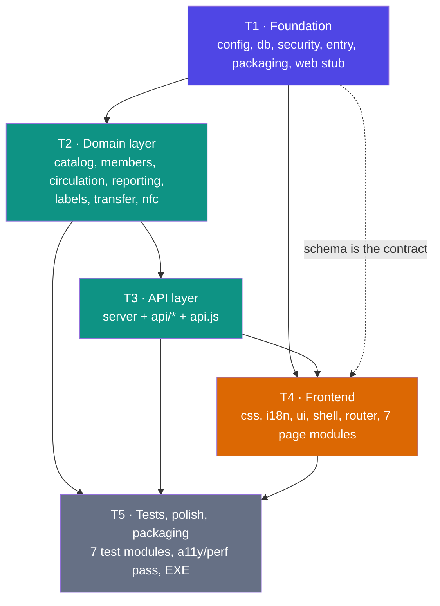

# IMRI — Task Breakdown

Companion to `docs/ARCHITECTURE.md`. **Read the architecture first**; this file only sequences the work.

| | |
|---|---|
| **Tasks** | 5 (hard ceiling — a 68-P0 app decomposed into more top-level tasks loses the dependency story) |
| **Steps** | 32, each scoped to concrete files |
| **Order** | `T1 → T2 → T3 → T4 → T5` (T4 may start once T1 lands; the API contract is frozen in `ARCHITECTURE.md` §4) |
| **P0 traceability** | all 68 IDs covered — see §6 |

---

## 1. Dependency graph

**Parallelism:** T4 does not need T2/T3 to be *finished* — only the contract. Once `T1.2` (schema) and the API table exist, the frontend can be built against stub responses. If the engineer is working single-threaded, follow the linear order; if batching, `T2` and `T4` are the two natural lanes.

---

## 2. Phase overview

| Task | Phase | Steps | Files | Gate to next task |
|---|---|---|:--:|---|
| **T1** | Foundation | 8 | 12 | `python main.py` starts a server that answers `/api/health`; `IMRI.db` is created with the full schema; `security` hashing + licence gate pass a manual smoke test |
| **T2** | Data layer | 8 | 7 | Every domain rule is callable from a Python REPL and covered by a hand-run scenario (issue → return → fine → payment → queue promotion) |
| **T3** | API layer | 5 | 7 | Every P0 endpoint answers correctly through `curl`/`fetch`, with the envelope, licence gate, 401/403 and pagination |
| **T4** | Frontend | 6 | 19 | All 16 screens reachable, operable and styled; Ctrl+K, theme, language switch, toasts, print all work |
| **T5** | Tests / polish / packaging | 5 | 10 | `tests/run_all.py` green; `dist/IMRI.exe` runs from a clean folder and survives a backup → restore |

---

## 3. Tasks and steps

### T1 — Foundation

> Goal: a running skeleton with the real schema and the real security primitives. No feature code.
> **Do not skip T1.2.** Every later step reads the schema; getting it wrong late costs a migration.

| Step | Name | Files | Depends | DoD |
|---|---|---|---|---|
| **T1.1** | Package, config, errors | `imri/__init__.py`, `imri/config.py`, `imri/errors.py` | — | `APP_NAME="IMRI"`, `APP_VERSION="1.0.0"`, `SCHEMA_VERSION=1`; `base_dir()`/`data_dir()`/`web_dir()` handle frozen vs dev; `now_utc()`, `today_local()`, `money()`; `ImriError(code,status,fields,details)` with `to_dict()`; `DEFAULT_SETTINGS` dict; `setup_logging()` writes `data/logs/imri.log` |
| **T1.2** | Schema + migrator | `imri/db.py` | T1.1 | Full DDL from ARCHITECTURE §3.3 executes twice with no error; every index and the two audit triggers exist; `Migrator.ensure()` writes `schema_meta(version=1)`; a DB with `version=99` raises `db_newer_than_app`; seeds all settings and the `admin/admin123` account with `must_change_password=1` |
| **T1.3** | Database access | `imri/db.py` | T1.2 | One long-lived connection, `isolation_level=None`, `foreign_keys=ON`, WAL, `synchronous=NORMAL`, `busy_timeout=5000`; `query/one/execute/executemany` under `RLock`; `transaction()` does `BEGIN IMMEDIATE` and rolls back on exception; `get_setting/set_setting/all_settings`; `audit()`; `checkpoint()`; `integrity_check()`; `row_counts()`; `busy` flag; `close()` |
| **T1.4** | Password hashing, sessions, RBAC | `imri/security.py` | T1.3 | `hash_password` → `scrypt$ln=14,r=8,p=1$salt$dk`; `verify_password` constant-time and accepts the PBKDF2 fallback; `needs_rehash` + rehash-on-login; `SessionStore` create/lookup/touch/revoke/revoke_user/purge_expired storing only `sha256(token)`; `ROLE_CAPS` exactly matching ARCHITECTURE §8.3; `caps_for(role)`; `login()` with 5-failures-per-5-min rate limit and `auth.login`/`auth.login_failed` audit |
| **T1.5** | Licence gate + recovery | `imri/security.py` | T1.4 | `LicenseGate.CODE` is the single literal `"arfanayub0"` compared via `strip().lower()` + `hmac.compare_digest`; `status()` reads `license.json` then the `settings` mirror and silently rewrites the file from the mirror (LIC-07); `activate()` writes the fingerprint record + mirror + audit; 5 failures → 30 s cooldown with `retry_after_s`; nothing written on failure; `RESET-ADMIN` marker consumed on startup with `must_change_password=1` and an audit row |
| **T1.6** | Entry point + single instance | `main.py`, `run.bat` | T1.5 | `main.py` resolves dirs, creates the data subfolders, takes `data/.lock` (`O_EXCL` + PID, stale-PID recovery), opens the DB, runs hold expiry, starts the server on `127.0.0.1:0`, prints nothing (all via `logging`), and blocks on the wait loop from ARCHITECTURE §12.3; `run.bat` launches via `pythonw` |
| **T1.7** | Web stub | `web/index.html`, `web/css/app.css` (tokens + shell only), `web/js/app.js` (boot stub) | T1.1 | `GET /` returns the HTML; `:root` and `[data-theme="dark"]` blocks carry every PRD §6.2 token; `app.js` imports cleanly and renders "IMRI" into `#app`; no inline `<script>` |
| **T1.8** | Packaging | `build_exe.py`, `build.bat` | T1.6 | `build_exe.py` runs the PyInstaller command from ARCHITECTURE §12.5 (`--onefile --windowed --add-data web;web` + the four `--hidden-import` api modules + tkinter/unittest excluded); `build.bat` is a one-liner; the produced EXE creates `data/` **next to itself**, not in `_MEIPASS` |

**T1 Definition of done:** `python main.py` starts; `curl http://127.0.0.1:PORT/api/health` returns `{"ok":true,…}`; `data/imri.db` contains 18 tables, 34 explicit indexes, 2 triggers, `schema_meta.version=1`, one `admin` user and 19 settings; a second `python main.py` detects the lock and exits; `python build_exe.py` produces a windowed EXE that opens the stub page.

---

### T2 — Domain layer

> Goal: every business rule, testable without HTTP. This is where the five risky points from ARCHITECTURE §13 live.
> Rule: **no `sqlite3` import outside `db.py`; no `http` import anywhere in `imri/*.py` except `server.py`.**

| Step | Name | Files | Depends | DoD |
|---|---|---|---|---|
| **T2.1** | Books: CRUD, validation, vocabulary | `imri/catalog.py` | T1.3 | `validate_isbn` (ISO 2108 check digits, 10 and 13), `to_isbn13`/`to_isbn10`, `validate_dewey` (`###(.###)?`), `validate_call_no` (≤64 chars), `validate_year`; `create_book`/`update_book`/`get_book`/`delete_book`/`list_books` with the frozen `_BOOK_COLUMNS` allow-list; `isbn10` derived on save; `set_subjects`/`set_languages`/`set_marc` round-tripping unknown MARC tags; `generate_accession`/`generate_barcode` (Code-39 safe `A–Z0–9`, unique); duplicate ISBN rejection; every mutation audited **inside the same transaction** |
| **T2.2** | Copies + rollup + lookup | `imri/catalog.py` | T2.1 | `add_copies(book_id, count)` creates `<accession>-1..N` barcodes and `copy_no` 1..N; `update_copy`/`delete_copy` with `copy_on_loan` guard; `refresh_book_rollup(conn, book_id)` is the **only** writer of `books.copies`/`books.status` and is called by every copy mutation; `available_copies()`; `lookup_barcode()`; `find_duplicates(isbn, title, authors)` |
| **T2.3** | Members | `imri/members.py` | T1.3 | `create/update/delete/list/get_member`; unique `member_code`; `validate_ic` (12 digits, dashes optional, non-numeric allowed but flagged); `profile(id)` returning current loans, history, fines, reservations, reading list and counts; `delete_member` refuses with `member_has_loans`; reading-list CRUD with `sort_order`; `reserve_from_reading_list` delegating to circulation |
| **T2.4** | Loans, fines, payments | `imri/circulation.py` | T2.2, T2.3 | `issue()` enforcing, in order: member exists & `status='active'` & not expired → copy exists & `available` → open loans < `max_loans` → not `copy_on_hold` for another member → insert loan + set copy `on_loan` + rollup + audit in one transaction; `return_copy()` computing `days_late` from **local** dates and `money(days_late * fine_per_day)`, then promoting the queue head to `ready` + copy `reserved` + `expires_at=+hold_days`, else copy `available`; `renew()` blocking on `renewal_count >= max_renewals`, on an open reservation, and on an overdue loan; `record_payment()` issuing `IMRI-R-YYYYMMDD-NNNN` and rejecting overpayment; `waive()` requiring a reason; `mark_lost()`; `accrued_fine`/`overdue_days`/`balance` helpers |
| **T2.5** | Reservations, queue, overdue | `imri/circulation.py` | T2.4 | `reserve()` rejecting duplicates and `title_available`; `cancel_reservation()`; `fulfil_reservation()`; `rebalance_queue(book_id)` using `ROW_NUMBER() OVER (PARTITION BY book_id ORDER BY reserved_date, id)` over `status IN ('open','ready')` with no gaps; `expire_holds(as_of)` expiring `ready` rows past `expires_at`, returning the copy to `available` and promoting the next — idempotent; `overdue_list(as_of)` and `active_loans()` paginated with `overdue_days` and `accrued_fine` |
| **T2.6** | Reporting + labels | `imri/reporting.py`, `imri/labels.py` | T2.2, T2.4 | `collection/circulation/membership/overdue_fines/trend/dashboard` returning `{title, columns, rows, totals}`; `dashboard()` in ~10 aggregate queries with no per-row loops; `PdfWriter` producing a valid PDF 1.4 with school name, report title, generated date, page numbers; `to_csv()` with UTF-8 BOM and the formula-injection guard; `LabelService` QR encoder (byte mode, GF(256) RS, 8-mask penalty scoring, versions 1–10) and Code 39 with caption, both emitting **SVG**; `book_label_svg`, `member_card_svg`, `sheet_svg(3x8 A4)` |
| **T2.7** | Import / export / backup | `imri/transfer.py` | T2.1, T2.3 | `HEADER_ALIASES` covering en/ms/zh synonyms; `read_table()` for CSV (`utf-8-sig`) and XLSX (`zipfile` + `ElementTree`); `preview_books/preview_members` performing **zero writes** to `books`/`members` (only `import_batches`/`items`) and caching rows under a UUID token with a 10-min TTL; `commit_*` inserting only `ok` rows in one transaction; `export_books/export_members` honouring the caller's filters and sort; `write_csv`/`write_xlsx`; `BackupService.create()` (zip + `MANIFEST.json` with path/size/sha256, verified after write), `list()`, `verify()`, `restore()` (manifest check → pre-restore snapshot → guarded extract → integrity re-check), `_safe_extract` refusing zip-slip, `_prune(keep)` |
| **T2.8** | NFC bridge | `imri/nfc.py` | T1.1 | `status()` returning `{available, reader, reason}` and never raising; `read_uid()`/`read_text()` via `ctypes` + `winscard.dll` with time-boxed APDUs; `write_text()` capped at 48 bytes; every entry point returns `(ok, value_or_reason)` so a machine with no reader is a normal state, not an error |

**T2 Definition of done:** a REPL script creates 1 book with 3 copies, 2 members, issues 2 copies, returns one 5 days late, asserts `fine == 1.00`, takes a RM0.40 payment, asserts `balance == 0.60`, reserves the title, returns the second copy, asserts the reservation became `ready` with `queue_position=1` and the copy is `reserved`, runs `expire_holds` 4 days later, asserts the copy is `available` and the reservation `expired`. Then `books.copies == COUNT(book_copies)` for every book.

---

### T3 — API layer

> Goal: the whole contract from ARCHITECTURE §4, reachable and correctly guarded.
> Rule: **handlers contain no SQL and no business rules** — they parse, authorise, delegate, serialise.

| Step | Name | Files | Depends | DoD |
|---|---|---|---|---|
| **T3.1** | HTTP plumbing + middleware | `imri/server.py` | T1.5, T2.* | `ThreadingHTTPServer` on `127.0.0.1:0`; static serving from `web_dir()` with the traversal guard and extension allow-list; the 8-stage middleware chain in the exact order of ARCHITECTURE §4.2; `{ok,data,meta}` / `{ok,error}` envelope; `ImriError` → HTTP mapping; `X-IMRI-CSRF` + `Origin`/`Sec-Fetch-Site` check; the full CSP header; 8 MB body cap; `inflight` counter; `Cache-Control: no-store` on `/api/*` |
| **T3.2** | App window + lifecycle | `imri/server.py` | T3.1 | `last_ping` tracking; `POST /api/auth/heartbeat` refreshes it; `POST /api/system/bye` arms a 3 s grace and a subsequent request cancels it; `should_exit()` implementing `bye` + 120 s heartbeat timeout; `AppWindow.launch()` probing Edge → Chrome → `webbrowser` with `--app`, `--window-size=1440,900`, `--user-data-dir=<data>/browser-profile`; `POST /api/system/reveal` restricted to `data/` + allow-listed extensions |
| **T3.3** | Router + core endpoints | `imri/api/__init__.py`, `imri/api/core.py` | T3.1 | `ROUTES` table with `@route(method, pattern, cap)` and path-param matching; `parse_page()` clamping `page_size` to 1..200 and validating `sort` against a per-route allow-list; handlers for health, bootstrap, licence activate/status, auth login/logout/session/password, heartbeat, dashboard, global search, settings GET/PUT with range validation, users CRUD + reset-password (revoking sessions, refusing to delete/demote the last admin or yourself), audit list + CSV export, system info/diagnostics/reveal |
| **T3.4** | Library + circulation endpoints | `imri/api/library.py`, `imri/api/circulation.py` | T3.3 | Every catalogue, copy, member, reading-list, import/export, issue/return/renew, loan, payment, waive, lost, fine, reservation endpoint from ARCHITECTURE §4.3, plus the NFC bridge (`GET /api/nfc/status`, `POST /api/nfc/read`, `POST /api/nfc/write`) which maps `(ok, reason)` from `imri/nfc.py` onto `nfc_unavailable`/`nfc_no_card`/`nfc_timeout`; every domain `ImriError` surfaces with its documented code and status (409 for rule violations, 422 for field validation, 404 for lookups); `X-IMRI-CSRF` required on all mutations |
| **T3.5** | Insights endpoints + API client | `imri/api/insights.py`, `web/js/api.js` | T3.4 | Reports (5 kinds + CSV/PDF export), labels (QR/Code39/book label/sheet), backup (list/create/verify/restore/delete); `api.js` exposing `get/post/patch/del/sendFile/download`, unwrapping the envelope, attaching `__meta`, throwing `ApiError{code,status,fields}`, sending `X-IMRI-CSRF`, and intercepting 401→`#/login` / 403 `license_required`→`#/activate` |

**T3 Definition of done:** a `curl` script walks the whole contract: unlicensed → `403 license_required` on `/api/books`; activate → login → dashboard 200; `viewer` gets `403 forbidden` on `POST /api/books`; `assistant` gets 200 on issue and 403 on delete; `?page=2&page_size=10` returns correct `meta`; a suspended member's issue returns `409 member_suspended`; `page_size=9999` is clamped to 200.

---

### T4 — Frontend

> Goal: 16 screens, one design system, no framework, no build.
> Rule: **no literal UI text in any `pages/*.js`** (I18N-04); **no raw hex below the token block** in `app.css`.

| Step | Name | Files | Depends | DoD |
|---|---|---|---|---|
| **T4.1** | Design system | `web/css/app.css`, `web/index.html` | T1.7 | Tokens for both themes; 8 px spacing scale; sidebar 240/64 + topbar 56 + content shell; buttons (36/32, 4 variants), inputs with focus ring + inline error, cards (20 px pad, 12 px radius, no rest shadow), tables (44 px rows, sticky header, sort caret, tabular numerics), pills, chips, modal (560/720, 16 px radius, blurred backdrop), drawer (480, 220 ms), toasts (360, bottom-right, max 3), palette (640, centred), skeletons (1.2 s shimmer), empty/error states, `prefers-reduced-motion` overrides, full print stylesheet (white, 12 mm, header/footer, no nav) |
| **T4.2** | i18n | `web/js/i18n.js`, `web/js/lang/en.js`, `web/js/lang/ms.js`, `web/js/lang/zh.js` | T1.1 | `t(key, vars)` with `{name}` interpolation and a visible `⟨key⟩` fallback; `setLang()` repainting without reload or data refetch (I18N-02); `fmtDate`/`fmtMoney`/`fmtNum` via `Intl` with `en-MY`/`ms-MY`/`zh-CN`; `checkCompleteness()`; all three catalogues carry the identical ~600-key set including every `err.<code>` from ARCHITECTURE §8.2 |
| **T4.3** | State + component kit + charts | `web/js/store.js`, `web/js/ui.js`, `web/js/charts.js` | T4.1 | `store` with session, settings, theme, lang, and per-route `listState` (filters/sort/page) surviving navigation; the full `ui.js` kit from ARCHITECTURE §11.3 with focus trap in modals, `aria-live` on toasts, keyboard-operable tables; `charts.bar/donut/sparkline` emitting inline SVG with token colours, 8 px rounded bars, 600 ms mount animation, no hover recomputation, correct in both themes |
| **T4.4** | Router + shell | `web/js/router.js`, `web/js/shell.js`, `web/js/app.js` | T4.3 | Hash router with query state, lazy `import()` per route, licence→login→screen guards, 120 ms content fade, back/forward preserved; sidebar with 5 groups + collapse + active indicator; topbar with page title, search, overdue bell, theme toggle, language chip, avatar menu, licence badge; Ctrl+K palette (grouped Actions/Books/Members/Go to, fuzzy match, ↑↓/↵/esc); global search grouped with counts ≤200 ms; shortcut registry feeding both the handler and the `?` sheet; theme resolution incl. `prefers-color-scheme`; heartbeat started; global `unhandledrejection` → toast |
| **T4.5** | Auth, dashboard, catalogue | `web/js/pages/auth.js`, `web/js/pages/dashboard.js`, `web/js/pages/catalogue.js` | T4.4 | Activation gate renders *instead of* the shell with no nav and a cooldown countdown; login with default-password banner ("Change it now / Remind me later"); dashboard with 6 KPI cards (+delta), due-today and overdue top-5 with click-through, 2 charts, 4 quick actions with focus, dismissible alerts strip; catalogue search-first with 150 ms debounce, highlight, filter chips, detail drawer (metadata + copies + current loans + history + MARC viewer), editor modal with per-field inline errors and unsaved-changes guard, copies panel, 3-step import wizard with dry-run preview and per-row reasons |
| **T4.6** | Members, circulation, insights, admin | `web/js/pages/members.js`, `web/js/pages/circulation.js`, `web/js/pages/insights.js`, `web/js/pages/admin.js` | T4.5 | Members list/search (name/code/IC), detail drawer with loans/history/fines/reservations/reading list, editor, member card preview; counter with scan-first issue/return keeping focus, "not found" without clearing the field, one-click renew, fine dialog with partial payment and receipt, overdue table with CSV export, reservations queue with positions + fulfil/cancel, NFC button degrading to a toast when unavailable; reports with range picker + 5 kinds + CSV/PDF; labels with live QR/Code39 preview, size/scale/quiet-zone options, batch sheet; admin 5 tabs (Licence & About with Copy diagnostics, Settings with range validation, Users & Roles, Backup/Restore with confirm + pre-restore snapshot path, Audit log with filters + CSV) |

**T4 Definition of done:** every screen renders its empty state with a working action; dark and light both readable; 1024×768 has no horizontal scroll; the counter can be driven entirely from the keyboard; switching language repaints without losing form input; every save produces a toast ≤150 ms; print preview of a report has no nav and correct header/footer.

---

### T5 — Tests, polish, packaging

| Step | Name | Files | Depends | DoD |
|---|---|---|---|---|
| **T5.1** | Test harness + foundation tests | `tests/helpers.py`, `tests/run_all.py`, `tests/test_db.py`, `tests/test_security.py` | T1.5 | Temp-dir DB fixture; seeded fixtures; `run_all.py` prints a pass/fail summary and sets the exit code; DDL is idempotent; migration from v0; rollup consistency; audit triggers abort UPDATE/DELETE; scrypt round-trip + rehash; capability matrix spot checks; session expiry; licence accept (`ARFANAYUB0`, ` arfanayub0 `) / reject / cooldown; `RESET-ADMIN` consumed exactly once |
| **T5.2** | Domain tests | `tests/test_catalog.py`, `tests/test_circulation.py` | T2.8 | ISBN check digits incl. `0-306-40615-2` → `9780306406157` and back; DDC/LCC validation; copy auto-generation; rollup after every copy op; duplicate detection; fine across a month boundary and a year boundary; `max_loans`; renewal blocked by reservation and by limit; queue positions gapless after cancel/fulfil/expire; partial payments accumulate; overpayment rejected; `ux_loans_active_copy` prevents a double issue |
| **T5.3** | Transfer + API tests | `tests/test_transfer.py`, `tests/test_api.py` | T3.5 | CSV/XLSX round-trip; header aliases (en/ms/zh); dry-run performs zero writes to `books`; commit imports only valid rows and records rejected ones; backup manifest + tampered-zip refusal + restore safety snapshot; restore with a zip-slip member is refused; envelope shape; `403 license_required`; the 401/403 matrix per role; pagination meta; the 12 riskiest domain error codes; `set(en)==set(ms)==set(zh)`; every `err.*` emitted in `imri/` has a key; no literal UI text in `pages/*.js`; no raw hex below the `app.css` token block |
| **T5.4** | Polish pass | `web/css/app.css`, `web/js/pages/*.js`, `imri/*.py` | T4.6 | Contrast ≥4.5:1 text / ≥3:1 borders in both themes; visible focus on every interactive element; every list has designed empty/loading/error states; 10k-title catalogue first paint ≤200 ms (seed script); dashboard ≤400 ms; save ≤100 ms; keyboard counter mode documented in the shortcut sheet; all `TODO`/`print()` removed; no console errors on any screen |
| **T5.5** | Package + release check | `build_exe.py`, `README.md`, `dist/IMRI.exe` | T5.4 | Clean-folder test: copy `IMRI.exe` to an empty folder → run → `data/` created beside it → activate → add a book → close (process exits within ~4 s, no orphan) → relaunch (still activated) → backup → delete `data/imri.db` → restore → data back; firewall test shows zero outbound connections; `grep` finds exactly one occurrence of the activation code and no `keygen`; README documents first run, activation, backup/restore, `RESET-ADMIN` |

**T5 Definition of done:** `python tests/run_all.py` exits 0 with every module green; the EXE round-trip above passes on a machine with the network cable unplugged.

---

## 4. Definition of done per phase

| Phase | Done means |
|---|---|
| **T1 Foundation** | A server answers, the schema is final, hashing and the licence gate work, the EXE builds. Nothing user-visible yet beyond a stub page. |
| **T2 Data layer** | Every rule in the PRD that is *not* presentation exists as a function with a documented error code, and the hand-run scenario in T2's DoD passes. Zero HTTP knowledge in these modules. |
| **T3 API** | The contract in ARCHITECTURE §4 is fully served and fully guarded. A `curl` walkthrough proves licence gate, auth, RBAC, pagination and error codes. The frontend can be built without reading Python. |
| **T4 Frontend** | All 16 screens are reachable in ≤2 clicks, operable by keyboard, correct in both themes and all three languages, with designed empty/loading/error states. |
| **T5 Ship** | Tests green, polish done, EXE verified from a clean folder with the network off. |

---

## 5. Deliberately deferred (P1 / P2)

Not scheduled. Listed so the engineer does not "helpfully" build them and so the schema does not grow:

| ID | Feature | Note |
|---|---|---|
| CAT-13 | Cover images | Column + `data/covers/` exist; no upload UI |
| CAT-14 | Duplicate warning UI | `find_duplicates()` exists; the modal hint is not wired |
| CAT-15 | Bulk actions | Endpoint exists (`POST /api/books/bulk`); no selection bar |
| CAT-16 | Saved filter views | Needs a table → future migration v2 |
| MEM-07/08/09/10 | Member card print, CSV import, photo, expiry auto-transition | Import endpoint exists for members; card endpoint exists |
| CIR-07/08/10/11 | Waiver UI, lost/damaged UI, hold shelf screen, counter keyboard mode | All *services* exist (T2.4/T2.5) — only UI/scheduling is missing |
| REP-06/08 | Trend comparison chart, print layout | Data exists; the dedicated layout is P1 |
| ADM-07/08 | Diagnostics screen, idle auto-lock | Diagnostics **endpoint** exists (needed for T5.1 assertions); the screen is P1 |
| BAK-03/04 | Backup list UI, scheduled backup | `backup_on_exit` setting is honoured in `main.py`; the pruning UI is P1 |
| LBL-04 | Batch label sheet | `sheet_svg()` exists; the UI is P1 |
| NFC-03 | Tag writing | `nfc.write_text()` exists; no UI |
| UX-09/10 | 1024×768 layout, undo-delete | 1024×768 is a T5.4 check; undo needs a soft-delete column → migration v2 |
| RDL-01/02/03 | Reading lists, class lists | The reading-list **panel on the member detail screen** is demanded by the member-detail P0 row and is therefore built in T2.3/T4.6. "Convert to reservation" (RDL-02) and class lists (RDL-03) are not. |

---

## 6. P0 traceability (68 requirements → steps)

| ID | Requirement (short) | Steps |
|---|---|---|
| LIC-01 | Gate blocks entire app | T1.5, T3.1, T4.5 |
| LIC-02 | Accept exactly `arfanayub0`, case/space tolerant | T1.5 |
| LIC-03 | Offline, one-time, perpetual, file + mirror | T1.5 |
| LIC-04 | No other code, no keygen in the build | T1.5, T5.5 |
| LIC-05 | Inline error + 5-attempt cooldown | T1.5, T4.5 |
| LIC-06 | Licence status visible, code never shown | T3.3, T4.6 |
| LIC-07 | Corrupt file → silent re-activate from mirror | T1.5 |
| DSH-01 | Six KPI cards with delta | T2.6, T4.5 |
| DSH-02 | Due-today + overdue top 5 with click-through | T2.6, T4.5 |
| DSH-03 | Two inline-SVG charts | T2.6, T4.3, T4.5 |
| DSH-04 | Four quick actions | T4.5 |
| DSH-05 | Alerts strip (0-available-with-holds, over-limit members) | T2.6, T4.5 |
| CAT-01 | Search-first list, debounced, highlighted | T2.1, T3.4, T4.5 |
| CAT-02 | Detail panel with copies/loans/history/MARC | T2.1, T3.4, T4.5 |
| CAT-03 | Add/edit modal with inline validation + unsaved guard | T2.1, T4.5 |
| CAT-04 | ISBN-10/13 validation, normalisation, conversion | T2.1 |
| CAT-05 | DDC + LCC capture, call-number validation | T2.1 |
| CAT-06 | Multi-value controlled subjects/languages | T2.1 |
| CAT-07 | 8 material types, enum enforced, filter chips | T1.2, T2.1, T4.5 |
| CAT-08 | Per-copy records with own barcode/status/location | T2.2, T4.5 |
| CAT-09 | CSV/XLSX import, dry-run, per-row errors | T2.7, T3.4, T4.5 |
| CAT-10 | Export the current filtered view, UTF-8 BOM | T2.7, T3.4, T4.5 |
| CAT-11 | MARC21-lite JSON blob, round-trip, editable | T2.1, T4.5 |
| CAT-12 | Accession/barcode auto-generation, Code-39 safe | T2.1, T2.2 |
| MEM-01 | CRUD students/teachers/patrons, delete blocked | T2.3, T4.6 |
| MEM-02 | Unique code, MyKad-aware IC validation | T2.3 |
| MEM-03 | Form/class/address/phone/email/membership date | T1.2, T2.3, T4.6 |
| MEM-04 | active/suspended/expired gates issuing | T2.3, T2.4 |
| MEM-05 | Detail: loans, history, fines, reservations, reading list | T2.3, T3.4, T4.6 |
| MEM-06 | Search by name/code/IC, partial, case-insensitive | T2.3 |
| CIR-01 | Scan-first issue, focus retained | T2.4, T4.6 |
| CIR-02 | Return with auto fine = days × rate | T2.4 |
| CIR-03 | Renew when no reservation and under limit | T2.4 |
| CIR-04 | Overdue list with days/fine/contact + CSV | T2.5, T4.6 |
| CIR-05 | Configurable loan_days/max_loans/max_renewals/fine_per_day/hold_days | T1.2, T2.4, T4.6 |
| CIR-06 | Fine ledger, partial payments, receipts, no overpayment | T2.4, T4.6 |
| CIR-09 | FIFO reservations, positions, auto-promote | T2.5, T4.6 |
| REP-01 | Collection statistics | T2.6, T4.6 |
| REP-02 | Circulation statistics over a range | T2.6, T4.6 |
| REP-03 | Membership statistics | T2.6, T4.6 |
| REP-04 | CSV export of any report | T2.6, T2.7, T3.5 |
| REP-05 | PDF export from a built-in writer | T2.6, T3.5 |
| REP-07 | Overdue & fines report matching the KPI | T2.6, T4.6 |
| ADM-01 | Settings with validation, applied immediately | T3.3, T4.6 |
| ADM-02 | Roles + enforced permission matrix (server-side) | T1.4, T3.1, T4.6 |
| ADM-03 | Change own password, admin reset, ≥8 chars, hashed | T1.4, T3.3, T4.6 |
| ADM-04 | Default-password nudge every login | T1.2, T3.3, T4.5 |
| ADM-05 | `RESET-ADMIN` marker recovery | T1.5 |
| ADM-06 | Audit log: every mutation, filterable, CSV | T1.3, T3.3, T4.6 |
| BAK-01 | Backup zip with verified sha256 manifest | T2.7, T3.5 |
| BAK-02 | Restore validates, snapshots, then swaps | T2.7, T3.5 |
| I18N-01 | en/ms/zh with full key coverage | T4.2, T5.3 |
| I18N-02 | Live switch, no restart, no data reload | T4.2, T4.4 |
| I18N-03 | Locale-aware date/number/currency | T4.2 |
| I18N-04 | No hard-coded UI strings | T4.2, T5.3 |
| LBL-01 | Offline QR for any copy or member | T2.6, T3.5 |
| LBL-02 | Offline Code 39 with caption, charset rejection | T2.6, T3.5 |
| LBL-03 | Label preview with size/scale/quiet-zone | T4.6 |
| NFC-01 | Detect reader, degrade gracefully | T2.8, T3.4, T4.6 |
| NFC-02 | Tag read fills the focused field and submits | T2.8, T3.4, T4.6 |
| UX-01 | Sidebar + topbar shell, ≤2 clicks, current section marked | T4.4 |
| UX-02 | Ctrl+K command palette | T4.4 |
| UX-03 | Global search grouped with counts | T3.3, T4.4 |
| UX-04 | Toasts for every mutation, aria-live | T4.3 |
| UX-05 | Dark/light, persisted, OS default | T4.1, T4.4 |
| UX-06 | Keyboard shortcuts + `?` sheet | T4.4 |
| UX-07 | Pagination/sorting/filter chips, state survives navigation | T4.3, T4.4 |
| UX-08 | Empty/loading/error states on every screen | T4.3, T4.6 |

**P0 count verified: 68/68 traced.** Every P1/P2 ID is accounted for in §5.

---

## 7. Working agreement

1. **Read `ARCHITECTURE.md` §3 before writing any SQL** and §4 before writing any handler. The schema and the contract are frozen; changing either means changing the doc in the same commit.
2. **Batch by step, not by file.** Each step above is sized for one working pass (~150–450 lines). Finish a step, run it, move on.
3. **Write the test for the risky step immediately** — T2.4 (fines), T2.5 (queue), T2.2 (rollup) and T3.2 (shutdown) are the four places where a plausible-looking implementation is wrong.
4. **Never `print()`.** Everything goes through `logging`; under `--windowed` there is no stdout and a stray `print` can raise.
5. **Never write to `_MEIPASS`.** Only `config.data_dir()`.
6. **No new dependency, ever** — including dev-only ones in `main.py`'s import graph. PyInstaller is the sole build-time tool.
7. **When the PRD is silent, take the decision from `ARCHITECTURE.md` §7 and record it there**, not in a code comment nobody will read.
